# Cronometer nutrition model and UX: fresh observations

Research date: 2026-10-12. Platform: Cronometer web app, signed-in Gold view. Method: direct computer use through `cua_repl`, accessibility text, screenshots, and visible controls. The account first opened the Professional app. Account → Cronometer Gold opened the personal app. No credentials are stored in this report.

GPT-6 Astra performed the core inspection and fixture tests. The primary agent added the report, repeat-item form, and historical-date checks through computer use after the Astra browser session ended.

This report describes the product interface and tested behavior. It does **not** establish Cronometer's physical database tables. A shared picker or a generic “Delete Food?” message is not proof of one storage table.

Evidence labels:

- **Observed:** read in the current app or executed and checked in this session.
- **Official-doc link:** a primary support link exposed by the app. The root specification contains the separate review of target documentation. A link here alone is not a claim that its full contents were checked in this browser session.
- **Documented:** behavior confirmed in an official support article. This label does not imply that the action was executed.
- **Inference:** a conclusion supported by observed behavior, with a limit stated.
- **Proposed:** a recommendation for Easy, not a claim about Cronometer internals.

## Main findings

1. **Observed:** foods, supplements, recipes, and saved meals share the food-add workflow, but the user-facing entities have different rules. Custom Foods, Custom Recipes, and Custom Meals have separate libraries and editors.
2. **Observed:** a supplement can be logged in capsules with no gram option. The custom food editor also starts with a serving whose gram mass is `n/a`. A required gram conversion would reject a supported use case.
3. **Observed:** a saved meal is a reusable collection of measured items. It logs as one named diary row with no quantity field in its add form. A recipe has serving conversion rules and logs a selected quantity and measure.
4. **Observed and tested:** exploding a saved meal copied its full item amount. Exploding one serving of a recipe scaled the ingredient amount to that serving. Both operations preserved the nutrition totals.
5. **Observed:** targets are not one flat set of numbers. Energy calculation, macro mode, carbohydrate definition, nutrient bounds, visibility, and weekday assignments are separate controls.
6. **Observed:** a Macro Scheduler template contains macros plus an optional custom energy target. The inspected template has no micronutrient rows.

## Flow coverage

| Flow | Coverage in this session | Limit |
|---|---|---|
| Sign-in and personal app access | Executed and verified | Professional client records were not opened |
| Diary groups and totals | Read; test entries logged in Breakfast | Group configuration was not changed |
| Food search and database source | Executed for banana and Vitamin D | Search ranking and all filter settings were not tested |
| Supplement serving | Inspected a real capsule item and its measure menu | Supplement was not logged |
| Custom food | Opened blank editor, serving cells, Advanced Info | No custom food was saved |
| Saved meal create/save/log/edit route | Executed with named disposable fixture | One food item; nested recipes and multiple meal items were not tested |
| Saved meal explosion | Executed and checked | Chose ONLY THIS TIME; did not enable automatic explosion |
| Recipe from selected diary item | Executed and saved | One ingredient |
| Recipe servings | Changed serving count, switched to weight mode, saved and checked | Cooked-weight adjustment was not found/tested |
| Recipe log and explosion | Executed and checked | Recipe revisions and nested recipe propagation not tested |
| Definition deletion and diary deletion | Executed on own fixtures, checked lists and diary | Retirement with existing historical references not tested |
| Copy and create-from-selection menus | Read; create-from-selection used for recipe fixture | Copy/paste was not executed |
| Repeat-item form | Opened food picker, selected banana, inspected unsaved schedule form | No repeat rule saved; diary prompt behavior is documented only |
| Macro/energy targets | Read current policy, breakdown and advanced settings | Did not change live targets |
| Fixed and keto modes | Switched modes in an unsaved new template | Canceled; no target template saved |
| Micronutrient bounds/visibility | Read General and Vitamins grids | Custom/Visible checkboxes were not changed |
| Weekday scheduler | Read assignment fields and new-template form | Scheduler remained disabled; date override not tested |
| Day complete and day copy/clear | Read menu | Did not mark a day complete or copy/clear a real day |
| Nutrition Report | Read period, inclusion, supplement, and day-filter controls; opened and cancelled custom dates | Non-empty numerical averages and actual denominator not tested |
| Historical diary date | Opened 11 October through the calendar; returned to Today | No historical values changed; target revision behavior not tested |
| Mobile app | Not exercised | Must not be treated as browser-verified |
| Cleanup | Diary empty again; named meal absent from list; recipe list returned to empty state | Existing unrelated custom meals were preserved |

## Food, supplement, and serving model

Route: `https://cronometer.com/#diary` → **FOOD** → **Add Food to Diary**.

**Observed:** picker tabs are `All`, `Favorites`, `Common Foods`, `Beverages`, `Supplements`, `Brands`, `Restaurants`, and `Custom`. Results have `Description` and `Source` columns. Sources seen include `NCCDB`, `CRDB`, `USDA`, and other databases. Selecting a result shows its name, a favorite star, macro summary, listed-nutrient count, and source link.

The add form exposes:

- `Time of day`, with `Include time` checkbox.
- `Diary Group`.
- `Serving Size`: `Amount` and `Measure`.
- `ADD TO DIARY`.

**Observed supplement example:** `Now, Vitamin D, 1000 lU, Vegetarian`, source `CRDB`, displayed `2 listed nutrients`. `Amount` defaulted to 1 and `Measure` to `capsule`. Opening the measure menu showed only `capsule`. No gram conversion or gram mass was displayed. The macro summary showed zero macros and zero energy; this was not an empty nutrient record.

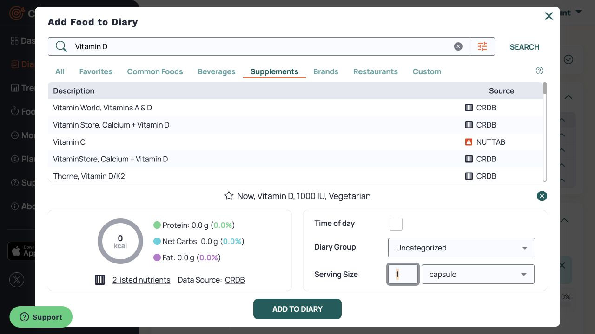

**Observed food example:** `Banana, Fresh`, source `NCCDB`, displayed `87 listed nutrients`. Default selection was 100 g. It contributed 88 kcal, 0.74 g protein, 23 g total carbs, 21.29 g net carbs, 1.7 g fiber, and 0.29 g fat in the recipe/meal overview. These numbers are test arithmetic evidence, not dietary guidance.

**Inference:** “Supplement” is a classification used for search and metadata. It does not require a separate logging mechanism. The UI supports nutrient-bearing portions without a mass conversion.

**Proposed for Easy:** keep source identity, nutrient data, portion identity, and optional gram mass distinct. Store unknown nutrient values as unknown, not automatically zero. Do not require grams to calculate nutrition when the record has a valid reference portion.

Primary support links exposed in the UI: [Food search](https://cronometer.zendesk.com/hc/en-us/articles/360018193011), [Data sources](https://cronometer.zendesk.com/hc/en-us/articles/360018239472-Data-Sources).

## Custom food editor

Route: `https://cronometer.com/#custom-foods` → **CREATE FOOD**.

**Observed:** the library describes this feature as creating food from a product's nutrition facts. The blank editor has `Food Name`, `Serving Sizes`, `Notes`, and collapsed `Advanced Info`. The initial serving table columns are `#`, `Measure`, and `Grams`, with row `1`, `Serving`, `n/a`. Clicking the serving name opens an inline text field.

`Advanced Info` contains `Barcodes`, `Category`, `Tags`, and `Translations`. Tags include `Whole`, `Brand`, `Restaurant`, `Supplement`, `Seafood`, `Vegetarian`, `Vegan`, `Dairy`, and `Nuts`. These labels also appear in the recipe Advanced Info screen. They are metadata choices, not separate editors.

The nutrition label is separate from the broad `Nutrition Overview`. The label format selector showed `American 2016`. `Nutrients in:` has amount and measure controls. Nutrient groups include General, Carbohydrates, Lipids, Protein, Vitamins, and Minerals. Blank values render as `-`; macro summaries say `Not Entered`. The label and detailed table can use different display units: Vitamin D appeared in `mcg` on the label and `IU` in the detailed table.

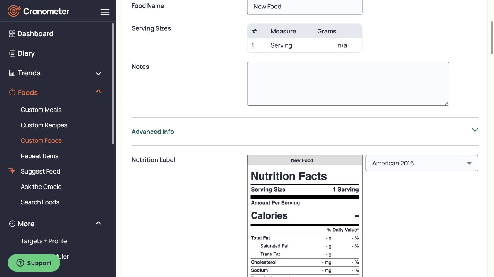

This was a read-only form inspection. No custom food was saved. [Custom food support](https://support.cronometer.com/hc/en-us/articles/360018240312).

## Diary group versus saved meal versus recipe

### Diary groups

**Observed:** today's diary had `Uncategorized`, `Breakfast`, `Lunch`, `Dinner`, and `Snacks`. Each group can collapse. Group headers show summed energy and macros when entries exist. A group's context menu includes `Add Food...`, `Sort Group By Time`, `Add Group Timestamp`, `Copy Selected Items`, `Create Recipe From Selected Items...`, `Create Meal From Selected Items...`, `Paste`, and `Delete Selected Items`.

**Inference:** a diary group is a bucket within a day. It is not the same entity as a reusable saved meal. Logging a saved meal into Breakfast preserved both levels: Breakfast group, then the named saved meal row.

### Saved meal: complete test

Route: `https://cronometer.com/#custom-meals` → **CREATE MEAL**.

**Observed:** editor fields are `Meal Name` and `Meal Items`; the add action is `ADD ITEM`. Item table columns are `Description`, `Database`, `Amount`, `Unit`, `Energy (kcal)`, and `Weight`, plus a delete icon. The screen has a nutrition overview, but no recipe serving/yield configuration.

Created and saved `Research 2026-10-12 Test Meal` with `Banana, Fresh`, 100 g. Saved UI identified it as `Meal #84938163, Data Source: Custom`. The library definition had `ADD TO DIARY`. Its add dialog was titled `Add meal to October 12, 2026` and showed Time of day and Diary Group. **There was no Amount/Measure or Serving Size section.** Selected Breakfast and logged it.

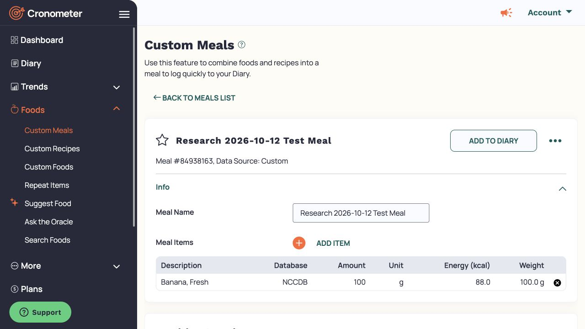

**Verified diary result:** one row named `Research 2026-10-12 Test Meal`, 88 kcal. The Breakfast group total became 88 kcal. The meal row had no amount or unit columns populated.

Right-click menu:

- `View/Edit Selected Meal`
- `Explode Meal`
- `Repeat Item`
- `Copy Selected Items`
- `Create Recipe From Selected Items...`
- `Create Meal From Selected Items...`
- `Paste`
- `Delete Selected Items`

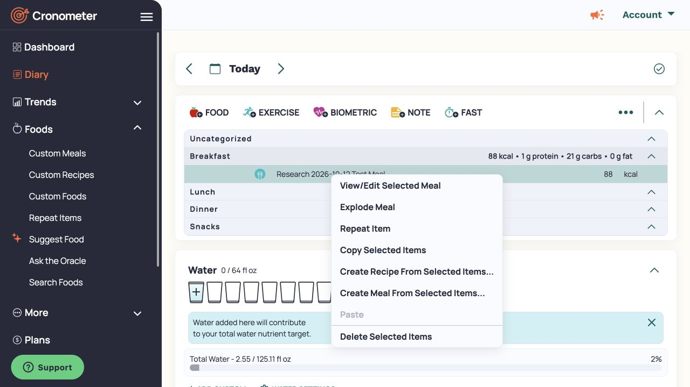

**Executed:** `View/Edit Selected Meal` navigated to `#custom-meals` and the same saved `Meal #84938163`. It opened the reusable definition, not a separate per-entry amount dialog. No definition edit was made at that point.

**Executed:** `Explode Meal` asked `Always Explode Meals?` with `ONLY THIS TIME` and `ALWAYS`. The text says the preference can be changed in More → Display → Diary Settings. Chose `ONLY THIS TIME`. The named meal row was replaced by `Banana, Fresh`, 100 g, 88 kcal. Group/day energy stayed 88 kcal.

**Inference:** the saved meal is a reusable bundle with item amounts. Explosion exposes its items for individual diary use. This does not establish whether the server stores a live reference, an embedded snapshot, or a versioned composite before explosion.

[Custom meal support](https://support.cronometer.com/hc/en-us/articles/17687459173908-Create-Custom-Meal).

### Recipe: complete test

**Executed:** from the exploded 100 g banana diary row, chose `Create Recipe From Selected Items...`. This opened a new recipe with the selected banana as an ingredient. Renamed it `Research 2026-10-12 Test Recipe`.

**Observed editor:** `Recipe Name`, `Ingredients`, `ADD INGREDIENTS`, ingredient table, `Serving Sizes`, `Notes`, and `Advanced Info`. Serving modes are `Serving Based` and `Weight Based`. Basic weight mode exposes `Serving Name` and `Grams per Serving`. `Advanced Serving Sizes` shows multiple portion definitions.

In Serving Based advanced mode, columns were `#`, `Serving Name`, and `Servings per Recipe`. There were built-in `full recipe` and `g` rows and an `ADD SERVING SIZE` action. Added a `Serving` row and set 2 servings per recipe. Switching to Weight Based converted that row to 50 `Grams per Serving` for the 100 g ingredient batch. Weight Based also displayed built-in full recipe, gram, and ounce conversions. Advanced Info displayed `Original Recipe Weight` of 100.0 g.

Saved definition: `Recipe #84938301, Data Source: Custom`. Nutrition label showed `1 Serving — 50g` and 44 calories. The full batch was 88 kcal. The recipe's own nutrition overview could be scaled with `Nutrients in:`.

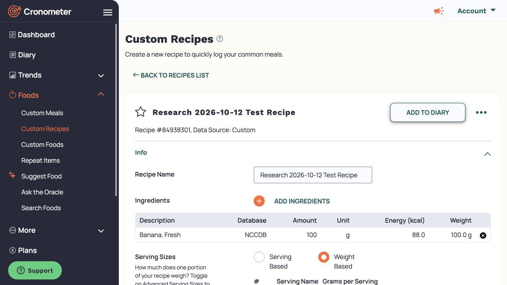

The screenshot covers the upper editor. Some detailed values above were read from accessibility text below the viewport, not from visible pixels in this screenshot.

**Executed:** recipe `ADD TO DIARY` opened `Add recipe to October 12, 2026`, with Time of day, Diary Group, and `Serving Size` containing Amount=1, Measure=`Serving — 50g`. Logged one serving under Breakfast.

**Verified diary result:** named recipe row with amount 1, measure `Serving — 50g`, 44 kcal. Together with the earlier exploded meal food, Breakfast total was 132 kcal.

Recipe context menu had `View/Edit Selected Recipe` and `Explode Recipe`, plus the common repeat/copy/create/paste/delete actions. Executed `Explode Recipe`. It replaced the recipe row with `Banana, Fresh`, 50 g, 44 kcal. The earlier 100 g banana remained separate. Total stayed 132 kcal.

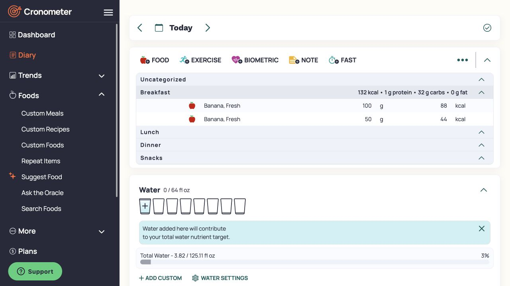

**Inference:** recipe servings scale constituent amounts. A reusable meal uses the full saved item amounts. A recipe and a saved meal therefore need different authoring and logging rules, even when a shared picker accepts both.

Definition overflow menus contained `Delete / Retire Recipe...` or `Delete / Retire Meal...`, `Edit a Copy`, `Display for printing...`, and `Export to CSV File...`. Only deletion of the disposable fixtures was executed; copy, export, and retirement behavior were not tested. [Recipe support](https://cronometer.zendesk.com/hc/en-us/articles/360018510311).

## Target configuration

### Energy, macros, and carb definition

Route: More → **Targets + Profile**, `https://cronometer.com/#profile`.

**Observed:** `Macro & Energy Targets` contains an `Energy Target` summary and expandable `SHOW TARGET BREAKDOWN`. The breakdown presents Basal Metabolic Rate, Baseline Activity Level, Baseline Expenditure, Energy Target, and Expenditure Above Baseline when logged. It explicitly links the calculation to profile, weight goal, and energy expenditure settings.

`Set Macro Targets` has `Ratios`, `Fixed Targets`, and `Keto Calculator`. The current live selection was Ratios. It displays grams and kcal derived from entered percentages, plus `Ratios Total`. Advanced settings contain:

- `Calculate as`: `%` or `Ratios`.
- `Custom Energy Target`, with notice that enabling it deactivates the weight goal.
- `Add Expenditure Above Baseline to Energy Target`.
- `Energy Summary 3rd Circle Display`: `Target` or `Balance`.
- `Track Carbs as`: `Net Carbs (default)` or `Total Carbs`.
- Net-carb `Exclude` checkboxes: Fiber, Sugar Alcohols, Allulose, Fructose.
- The active equation was `Net Carbs = Total Carbs - Fiber - Sugar Alcohols`.

The page also has Energy Expenditure controls for Baseline Activity, BMR Default/Custom, and Thermic Effect of Food. They were read only. None of the live policy controls were changed.

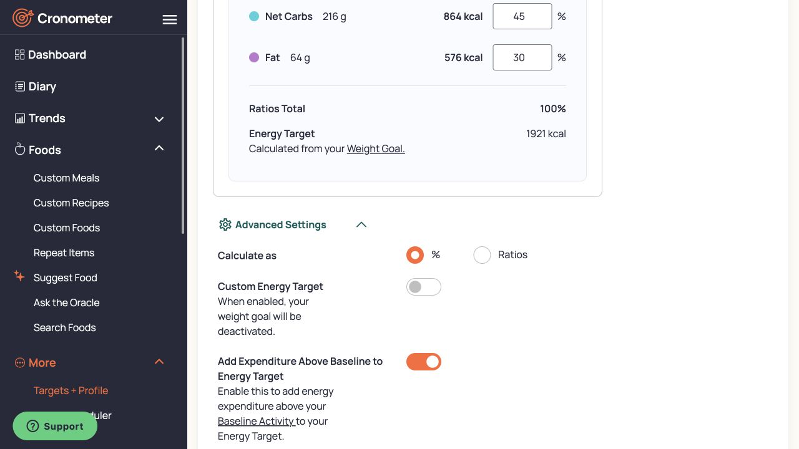

### Nutrient bounds and visibility

**Observed:** `Nutrient Targets` says to select nutrients to track and edit minimum and maximum targets. Tabs: General, Vitamins, Minerals, Carbohydrates, Lipids, Protein. Columns: `Nutrient`, `Daily Target`, `Maximum`, `Units`, `Custom`, `Visible`.

The General Energy row showed `Dynamic` rather than an independent static target. Other nutrients could have no target or maximum. Vitamin rows supplied clear examples of independent optional bounds:

| Nutrient | Daily Target | Maximum | Unit | Custom | Visible |
|---|---:|---:|---|---|---|
| B12 (Cobalamin) | 2.4 | — | µg | Off | On |
| B3 (Niacin) | 16 | 35 | mg | Off | On |
| Biotin | 30 | — | µg | Off | Off |
| Choline | 550 | 3500 | mg | Off | Off |
| Retinol | — | 3000 | µg | Off | Off |
| Vitamin D | 600 | 4000 | IU | Off | On |

These are the account's displayed values, not universal defaults or recommendations. The table supports lower-only, upper-only, both-bound, and no-bound states. Custom and Visible are independent controls. No Custom or Visible checkbox was changed, so the exact inline-edit/save interaction is not browser-verified here. The official-doc review in the main spec supports their meaning.

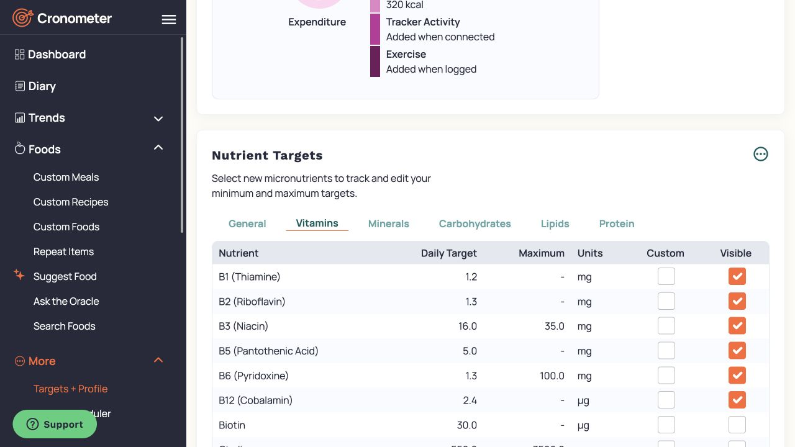

### Scheduler and unsaved template inspection

Route: More → **Macro Scheduler**, `https://cronometer.com/#macro-scheduler`.

**Observed:** `Enable Scheduler` was off. The screen explains that enabling it allows weekday templates, the Daily Target Editor, and template display in the diary. Each Sunday–Saturday selector showed `Default Macronutrient Targets` and was disabled while the scheduler was off. `+ NEW TEMPLATE` was available. No templates existed.

Opened `New Target Template` and inspected its modes without saving. It contained `Template Name`, the three macro modes, and `Custom Energy Target`. The energy override text says it overrides the default energy target on days that use the template. No vitamin, mineral, or other nutrient rows were present.

**Fixed Targets observed:** Protein, Net Carbs, Fat, and `Fixed Targets Total`. Advanced setting `Calculate targets using` supports `kcal` or `grams`. Switched the unsaved form to grams; each macro then used gram inputs with derived kcal and percentages. The form recommends a custom energy target when using fixed macro targets. No forced equality between macro-derived energy and the optional energy override was tested.

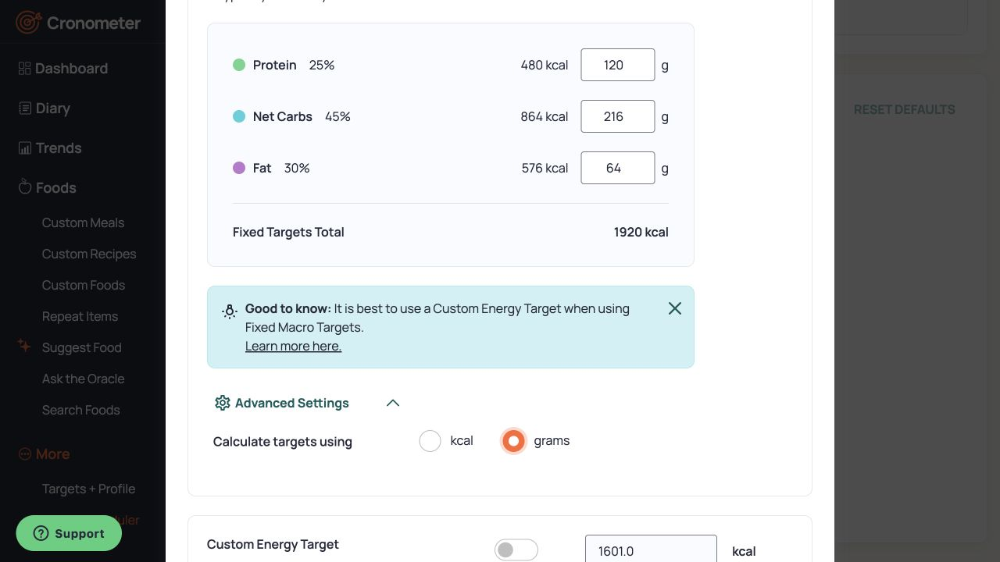

**Keto Calculator observed:** program choices `Rigorous`, `Moderate`, `Relaxed`, `Custom`; `Athletic Bonus`; grams of protein per kg of lean body mass; grams of non-fiber carbohydrates per day. Custom enabled editing of those values. The interface showed that body fat is used to estimate lean body mass. No values were entered and nothing was saved.

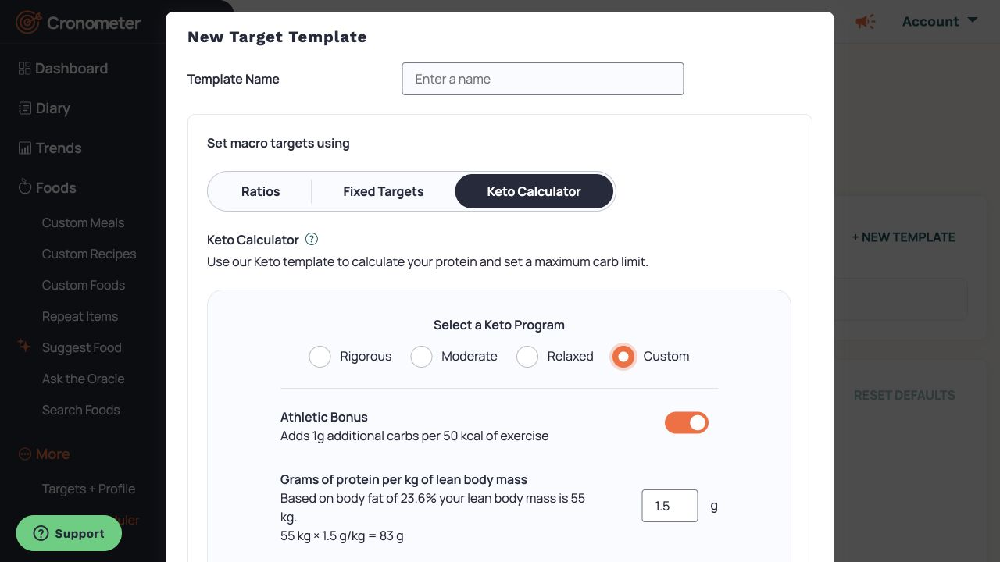

Pressed `CANCEL`. Scheduler remained off and the template list remained empty. This inspection does not prove effective-date behavior, history recalculation, weekday reassignment effects, or same-day precedence. Those require the official-doc evidence in the main spec and explicit Easy design decisions.

Primary links exposed in the UI: [Macro targets](https://cronometer.zendesk.com/hc/en-us/articles/360060119292), [Ratios](https://cronometer.zendesk.com/hc/en-us/articles/360020446112), [Fixed targets](https://cronometer.zendesk.com/hc/en-us/articles/360020446432), [Keto calculator](https://cronometer.zendesk.com/hc/en-us/articles/360018825091), [Energy target](https://support.cronometer.com/hc/en-us/articles/31975503009044-Energy-Target), [Macro scheduler](https://support.cronometer.com/hc/en-us/articles/4406127050260).

## Day scope, totals, and completeness

**Observed:** the diary provides day navigation, per-group totals, Energy Summary, energy/macronutrient target bars, Nutrition Scores, Highlighted Nutrients, detailed nutrient tables, and Nutrient Balances. Selection of a row changes the nutrition display context; do not assume every visible nutrient number always represents the whole day.

The day overflow menu contains `Mark Day Complete`, `Copy Previous Day`, `Copy Current Day`, `Paste`, `Clear All`, `Clear Amounts`, `Sort All By Time`, and `Diary Settings...`. These actions were read but not executed. The existence of Mark Day Complete is evidence for explicit completeness state, not proof of how reports use it.

Dashboard `Quick Add to Diary` exposes Food, Exercise, Biometric, and Note buttons. This is not evidence of a macro-only quick-add entry. No macro-only quick-add form was found in the screens inspected.

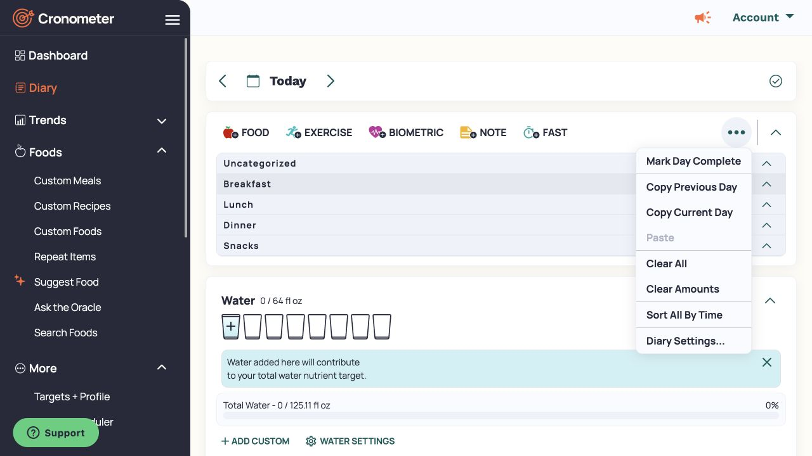

## Reports, history, and repeat items

### Report selection

Route: Trends → Nutrition Report, `https://cronometer.com/#nutrition-report`.

**Observed:** the page describes its result as daily averages. Its controls are `Daily Averages for`, `Include Today`, `Filter Days`, and `Include Supplements`. The inspected state used Last 2 weeks and All Days, with both inclusion checkboxes selected. The date label showed 29 September to 12 October 2026.

`Filter Days` contains `All Days`, `Non-Empty Days`, and `Completed Days`. The period menu contains Last 7 days, Last 2/3/4/8 weeks, Last 3/6 months, Last year, All Time, and Custom Range. Custom Range opened separate Start and End calendars. Cancel restored Last 2 weeks. No filter choice or custom date was applied.

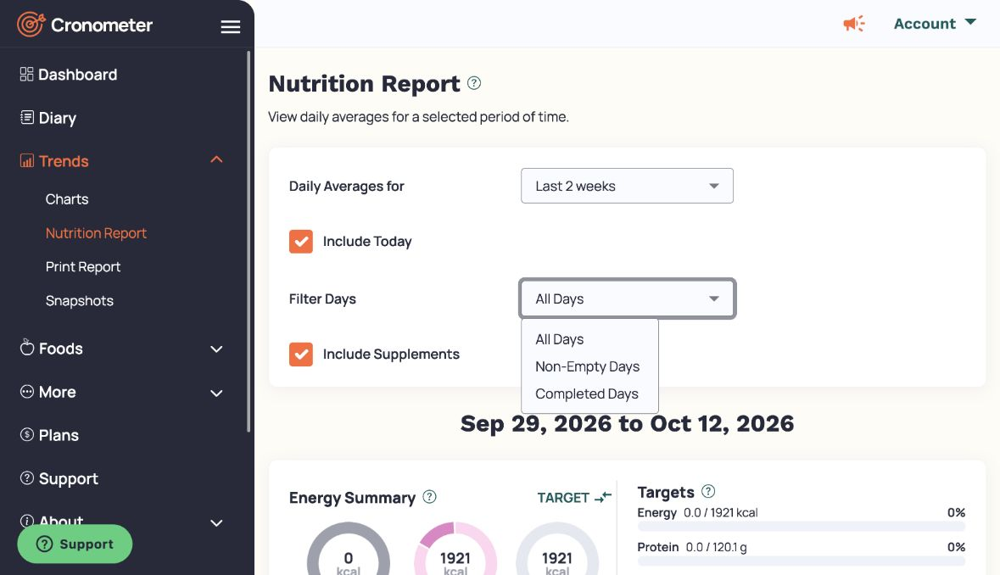

**Documented:** the report gives daily averages for the selected period. Completed-day filtering uses the diary's explicit completion state. Excluding today avoids including a partly recorded day. The supplement checkbox controls inclusion of supplements. [Nutrition Report](https://support.cronometer.com/hc/en-us/articles/360018569691-Nutrition-Report)

The empty intake data could not establish the actual numerical denominator, missing-nutrient arithmetic, or handling of supplement ingredients inside recipes.

### Historical dates

**Executed:** opened the diary calendar, selected 11 October 2026, and waited for its records to load. The heading changed to Oct 11 and the diary showed an existing biometric record. No record was changed. Selected 12 October, closed the calendar, and verified Today with empty food groups again.

This verifies date navigation. It does not verify how past targets respond to later target edits.

### Repeat-item form

Route: Foods → Repeat Items, `https://cronometer.com/#repeat-items`.

**Observed:** the list was empty. Add Item opened `Select Item to Repeat`, using the food picker and its source tabs. Selected `Banana, Fresh`. The picker offered Diary Group, Amount, Measure, and `SET REPEAT`.

**Executed without save:** `SET REPEAT` opened a schedule editor. It had Timestamp with `Include time`, Diary Group, Serving Size with Amount and Measure, individual Sunday–Saturday selectors, and All Days. With no day selected, it said `Please select at least one day to repeat on`. The nutrition preview used the selected portion. Back to List returned to the empty repeat-item list. No rule was created.

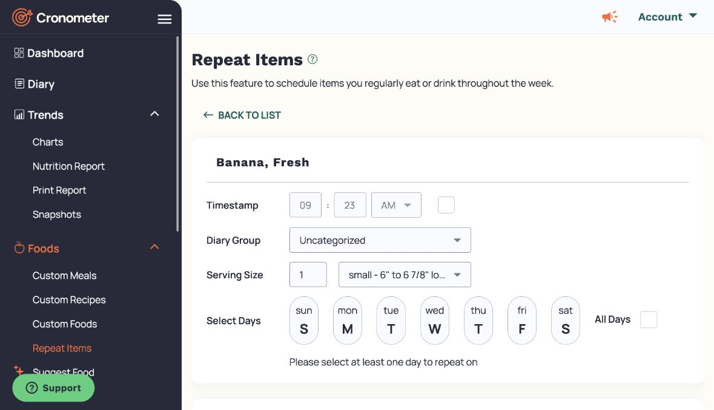

**Documented:** after a repeat rule is saved, opening a matching diary date shows a prompt with `LOG ITEMS`. The guide also describes separate disable and delete actions for repeat rules. These actions were not executed. [Set Repeat Items](https://support.cronometer.com/hc/en-us/articles/17685528192020-Set-Repeat-Items)

**Proposed for Easy:** a schedule describes expected intake. Saving or matching that schedule must not itself establish consumption.

## Cleanup and limits

Created only these named research definitions: meal #84938163 and recipe #84938301. The two resulting diary food entries were selected through the Breakfast group. The delete dialog explicitly said two items. Confirmed removal and checked that the diary had no entries and zero consumed nutrition again.

Removed both research definitions through their own Delete / Retire menu and name-specific confirmation. Returned to the lists to check the result. The named research meal was absent; unrelated existing custom meals remained. The recipe list returned to its create/import empty state. The app retained stale editor content when navigating back to a deleted definition's route; list verification was therefore required. No unrelated custom items were changed.

No account targets, weekday assignments, profile values, subscriptions, or repeat schedules were saved. The only target-mode changes took place inside a canceled new-template form. No day was marked complete. The blank custom food was not saved.

The report custom-date dialog was cancelled and returned to its prior period. The unsaved repeat-item form returned to an empty list. The diary was restored to Today after the historical-date check.

Unverified points that must remain explicit: composite revision propagation; whether diary nutrition is stored as snapshots; nested recipe/meal rules; stale-source handling; cooked recipe yield adjustment; retirable definitions with references; report denominators; history and same-day target precedence; all mobile behavior. None can be inferred from shared screens or action names alone.
