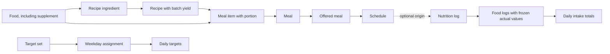

# Nutrition model and UX proposal from Cronometer research

Research date: 12 October 2026.

Status: proposed design. This file gives concrete decisions for review. It does not change the accepted glossary, application, or database.

The companion [Cronometer observation record](cronometer-observations.md) records the computer-use flows, screenshots, and access limits. A GPT-6 Astra agent performed the core inspection and saved-item tests. The primary agent added report, repeat-item, and historical-date checks. This proposal also uses official Cronometer documentation and direct reads of Easy's code.

## 1. The two answers

### Do meal, recipe, supplement, and food use the same table?

For Cronometer, the physical tables are unknown. Screens and shared search results cannot establish a private database schema.

The earlier authenticated API capture provides stronger evidence about the interface. `GET /api/v3/user/{user_id}/food-search/string` returned a search-result schema with `id`, `name`, `type`, `category`, `meal`, `recipe`, `recipeOrMeal`, `measureId`, and `measureDisplayName`. The three meal/recipe fields are booleans. This supports a common search representation with item-kind flags. [Captured response schema](../nutrition/cronometer/evidence/live-response-schemas.txt)

The capture did not preserve example values for each item kind. It therefore does not establish how supplements are encoded in `type` or `category`. Requests naming `getFood` were seen after food selection, but their response bodies were unavailable. Recipe and meal detail or save contracts were not captured. [Request evidence](../nutrition/cronometer/evidence/network-models.json)

Thus, **a shared API search model is observed; separate physical tables are our proposed design, not a finding about Cronometer**. A shared catalogue table with composition records could also produce that API. The API evidence alone cannot choose between those storage designs.

For Easy, use the following design:

| Concept | Storage decision | Reason |
|---|---|---|
| Food | `foods` | Holds supplied nutrient values and portion conversions. |
| Supplement | `foods`, with `kind = supplement` | Uses the same portion and nutrient rules. It can have a capsule, scoop, or mass portion. |
| Recipe | `recipes` | Holds ingredients, preparation, and batch yield. Its nutrients come from its ingredients. |
| Reusable meal | Proposed `meals` table for library definitions | Holds items eaten together. It has no batch yield. Client meal copies can stay inside plan content. |
| Recorded intake | Diary records | Holds what was eaten, when, and in what amount. It must survive edits to the source library. |

**Recommendation: food and supplement share a table. Recipe and meal remain separate concepts and records.** One search component can return all of them.

Keep the separate Food and Recipe aggregates required by [ADR 0002](../../docs/adr/0002-nutrition-module-ownership.md). Do not add a duplicate Food row for every Recipe. A recipe is selectable as a prepared item through the shared search and portion interface.

Three possible designs were considered:

| Design | Main cost | Decision |
|---|---|---|
| One table with four kinds | Mixes direct nutrient data, calculated batches, and reusable groups. Requires different rules for many nullable fields. | Reject. |
| Separate food, supplement, recipe, and meal tables | Duplicates food portions and nutrients in the supplement model. | Reject. |
| Food includes supplements; recipes and meals have their own content | Requires a typed item reference, which Easy already has. | Use. |

### How are nutrition targets configured?

Cronometer has several layers: profile defaults, energy settings, a macro calculation mode, individual nutrient settings, and macro schedules. The details are in section 3.

For Easy, start with explicit daily targets entered by the coach. Store a named set of nutrient bounds. Assign a set to selected weekdays. Resolve at most one complete set for a client-local date. Meals never create, replace, or add to these targets.

Use `min` and `max` as the stored form. The editor presents **Exactly**, **At least**, **At most**, **Between**, and **No target**. These are five UI choices over one data shape, not five target models.

## 2. What the live flows establish

The fresh computer-use tests saved and logged temporary meal and recipe fixtures. They did not stop at opening the editors. The detailed record and captures are in [Cronometer observations](cronometer-observations.md).

| Tested action | Observed result | Design lesson |
|---|---|---|
| Select a supplement | The selected vitamin D product offered capsule as its only measure. It showed no gram measure. | A user-facing portion cannot require mass for every item. |
| Save a meal with 100 g banana | The meal editor had named items and amounts, with no recipe yield. | A meal is a reusable combination. |
| Add that meal to the diary | The add dialog asked for time and diary group, with no amount or measure. The diary showed one 88 kcal meal row. | A saved meal can be a single visible row without behaving like a recipe serving. |
| Explode that meal for this time | The row became banana, 100 g, with the same 88 kcal. | Expansion changes the representation of this intake. It must not double-count the parent. |
| Create a recipe from 100 g banana with two servings | Weight-based yield showed 50 g per serving. Logging one serving gave 44 kcal. | Recipe portions scale a prepared batch. |
| Explode that recipe | The row became banana, 50 g, still 44 kcal. | Ingredient expansion preserves the consumed fraction. |

The researcher removed the test intake and definitions. The diary was empty again after the fixture test. Full cleanup verification belongs in the observation record.

The meal context action **View/Edit Selected Meal** opened its reusable definition. Easy should make **Edit this intake** and **Edit saved meal** separate actions so the user can see the scope.

### Words with one meaning

These are the recommended Easy terms. Cronometer's observed terms and actions are recorded separately in the companion report.

| Term | Meaning | Example |
|---|---|---|
| Food | A catalogue item with supplied nutrients for a reference amount | Rolled oats |
| Supplement | A food classification | Calcium capsules |
| Recipe | A prepared batch with ingredient quantities and yield | Four servings of soup |
| Ingredient | A food used in a recipe | Lentils in soup |
| Meal | A reusable list of foods and recipe portions | Soup, bread, and yogurt |
| Meal item | One prescribed item and its portion in a meal | 250 g soup |
| Schedule | When a client is offered one meal or a choice of meals | Breakfast, weekdays, 08:00 |
| Offered meal | One complete alternative in that schedule | Oats bowl or eggs on toast |
| Diary group | A display category for intake | Breakfast |
| Nutrition log | One recorded consumption occasion | Breakfast eaten on Monday |
| Food log | One actual item within a nutrition log | 180 g soup |
| Target set | A complete named set of daily nutrient bounds | Training day |

A label such as Breakfast is not an identity. Two intake occasions can have the same label on the same date.

A food can be eaten alone. A recipe can be eaten alone. A meal can contain one item. These facts do not make their authoring rules identical.



Arrows show relationships. They do not mean that every box requires a table.

## 3. How Cronometer configures targets

The live screen paths and fields are recorded in the observation file. The following behavior also has official documentation.

| Layer | Configuration and effect | Official source |
|---|---|---|
| Profile | Age, sex, height, weight, and relevant life stage inform default energy or nutrient values. | [Targets + Profile](https://support.cronometer.com/hc/en-us/articles/31308427612180-Targets-Profile) |
| Energy | The app can calculate an energy target from the weight goal or accept a custom energy target. | [Targets + Profile](https://support.cronometer.com/hc/en-us/articles/31308427612180-Targets-Profile) |
| Expenditure | BMR, activity, device activity, exercise, and optional thermic effect contribute to estimated expenditure. Activity adjustments prevent duplicate exercise credit. | [Energy Expenditure](https://support.cronometer.com/hc/en-us/articles/31974307318420-Energy-Expenditure) |
| Fixed macros | Enter protein, carbohydrate, and fat amounts. Advanced settings also permit kcal input. | [Fixed Macronutrient Targets](https://support.cronometer.com/hc/en-us/articles/360060569911-Fixed-Macronutrient-Targets) |
| Macro ratios | Divide the energy target among macros. A changed energy target can change the gram targets. | [Macro Ratios](https://support.cronometer.com/hc/en-us/articles/360020446112-Macro-Ratios) |
| Keto | Calculate protein and carbohydrate limits, then allocate remaining energy to fat. | [Keto Calculator](https://support.cronometer.com/hc/en-us/articles/360018825091-Keto-Calculator) |
| Carbohydrate basis | Select total or net carbohydrates. This changes which quantity the target measures. | [Edit Macronutrient Targets](https://support.cronometer.com/hc/en-us/articles/360060119292-Edit-Macronutrient-Targets) |
| Individual nutrients | Set a Daily Target and optional Maximum Threshold. Custom values replace default DRI values. Visibility controls which nutrients appear in the summary. | [Nutrient Targets](https://support.cronometer.com/hc/en-us/articles/360060170532-Nutrient-Targets) |
| Weekly schedule | Save macro templates and assign them to weekdays. A template can use default energy settings or a custom energy target. | [Macro Scheduler](https://support.cronometer.com/hc/en-us/articles/4406127050260-Macro-Scheduler) |
| Date override | Change one selected diary date without changing the repeating macro schedule. | [Macro Scheduler](https://support.cronometer.com/hc/en-us/articles/4406127050260-Macro-Scheduler) |

The live nutrient grid has **Daily Target**, **Maximum**, **Units**, **Custom**, and **Visible** columns. The inspected new scheduler template has macro controls and **Custom Energy Target**, with no micronutrient rows. The researcher cancelled that draft and left the scheduler disabled. [Live target inspection](cronometer-observations.md)

The Macro Scheduler documentation also describes macro and energy settings. It does not establish a schedule for every micronutrient. Easy's complete target set is our design choice.

The individual nutrient editor only permits macro edits there when fixed macro values are in use. In other modes, the macro calculator owns those values. A **Visible** setting is not a target amount. A **Maximum Threshold** is not another daily goal. [Nutrient Targets](https://support.cronometer.com/hc/en-us/articles/360060170532-Nutrient-Targets)

Cronometer documents different history rules for different actions. Editing a template can affect past dates. Assigning a template to a weekday applies forward. **Edit a Copy** preserves the earlier template. Easy should use one explicit revision rule for all prescription edits. [Mobile Macro Scheduler](https://support.cronometer.com/hc/en-us/articles/4406120372244-Mobile-Macro-Scheduler)

Fixed macro values and an independently calculated energy target can differ. Cronometer exposes a custom energy target to make them match if desired. Easy should show such a difference without silently changing either value. [Mobile Fixed Targets](https://support.cronometer.com/hc/en-us/articles/33231653421588-Mobile-Fixed-Targets)

## 4. The target model for Easy

### Stored values

Keep the existing nutrient codes and units as the contract. For example, `energy_kcal`, `protein_g`, and `sodium_mg` are distinct registered codes. Add a nutrient through that registry before it appears in food data, targets, or reports.

```json
{
  "id": "training",
  "name": "Training day",
  "targets": {
    "energy_kcal": {"min": 2400, "max": 2400},
    "protein_g": {"min": 150},
    "fat_g": {"min": 60, "max": 80},
    "sodium_mg": {"max": 2300}
  }
}
```

These numbers are software examples, not dietary recommendations.

| Editor choice | Stored form | Meaning |
|---|---|---|
| No target | Omit the nutrient key | Intake can still be recorded and displayed. |
| Exactly 2400 kcal | `min: 2400, max: 2400` | A numeric goal. Show the difference from it. |
| At least 150 g | `min: 150` | A lower bound. |
| At most 2300 mg | `max: 2300` | An upper bound. |
| Between 60 and 80 g | `min: 60, max: 80` | An inclusive range. |

Reject negative, non-finite, or inverted bounds. Require at least one bound for a stored nutrient target. Zero is valid. Empty input removes a target; it does not create zero.

Do not persist both a mode and bounds. The UI can derive the mode without a second value to keep in sync.

### Weekday assignments

Store target definitions separately from their weekday assignments within the prescription document:

```json
{
  "target_sets": [
    {
      "id": "training",
      "name": "Training day",
      "targets": {
        "energy_kcal": {"min": 2400, "max": 2400},
        "protein_g": {"min": 150}
      }
    },
    {
      "id": "rest",
      "name": "Rest day",
      "targets": {
        "energy_kcal": {"min": 2100, "max": 2100},
        "protein_g": {"min": 150}
      }
    }
  ],
  "target_assignments": [
    {"target_set_id": "training", "weekdays_mask": 21},
    {"target_set_id": "rest", "weekdays_mask": 106}
  ]
}
```

This example has two complete sets. Monday is bit 1. Mask 21 means Monday, Wednesday, and Friday. Mask 106 means Tuesday, Thursday, Saturday, and Sunday.

For a date:

1. Use the client's local calendar date and the nutrition plan that covers it.
2. Select the effective immutable plan revision, using the history rule in section 8.
3. Find the target assignment that contains that weekday.
4. Return its complete target set, or no targets if there is no assignment.
5. Reject a revision with two assignments for the same weekday.

The week editor moves a weekday from its prior set in one save when the coach selects another set. It never merges the nutrient maps. A rest set without a sodium target does not inherit sodium from the training set.

An assignment must reference a set in the same prescription. Its mask must be an integer from 1 through 127. Remove an empty assignment instead of storing a zero mask. An unused target definition can remain available for later assignment.

The first release keeps the agreed repeating-week scope. Date-specific overrides remain deferred. When added, one explicit date override will replace the complete set before the weekly lookup. An override to **No targets** must be distinguishable from no override.

### Coach target flow

Open **Client → Nutrition week → Targets** for a day. Show the selected set, its weekdays, and its nutrient values in one dialog.

The first visible fields are energy, protein, carbohydrate, and fat. **Add nutrient** exposes the rest of the supported registry. Each row has one mode selector, the required numeric fields, and a fixed unit label.

Offer **Edit this set** and **Use a copy for Monday**. Before save, name the days affected by a shared-set edit. Selecting **No targets** changes the weekday assignment; it does not delete the reusable set.

Keep energy explicit. Meals and completed workouts do not recalculate it. A ratio calculator can be added later as an input aid that produces explicit values after review. Do not add a live expenditure engine in this release.

Use total carbohydrate as the initial supported basis. Label it clearly. Do not introduce a net-carbohydrate switch until the food contract and missing-fiber rules support it.

### Client target display

Show **Recorded / Target** with the target form intact. Examples are `120 g / at least 150 g` and `1700 mg / at most 2300 mg`.

Do not show a maximum-only target as a bar that rewards approaching the limit. Do not treat an exact target as a pass-or-fail adherence test. Show the numeric difference. Unknown intake produces **Incomplete data**, not **Target met**.

Target visibility is a display preference. It must not remove a saved prescription. No target means no target comparison, not a zero goal.

## 5. Food, recipe, and meal rules

### Food and supplement portions

Use a reference amount with a dimension and optional count label:

| Example basis | Example serving conversion |
|---|---|
| Nutrients per 100 g | One slice equals 30 g. |
| Nutrients per 100 ml | One glass equals 250 ml. |
| Nutrients per 2 count, label capsule | One capsule equals 1 count. |

Minimum food fields are identity, owner, name, kind, source, reference amount, nutrients, and servings. A serving has a stable ID, label, and positive amount in the reference dimension.

Resolve a selected amount into the reference dimension. Then apply:

```text
portion nutrient = reference nutrient × selected reference amount / reference amount
```

For a synthetic label with 400 mg calcium per two capsules, one capsule contains 200 mg. No gram mass is needed. Dose units and nutrient units are separate.

Do not convert millilitres to grams without a known conversion. Do not assign a fake mass to capsules. Existing foods migrate with a reference of 100 g. Existing serving grams remain valid conversions.

A missing nutrient is unknown. An explicit zero is known. Do not fill an unlisted supplement's energy or macros with zero automatically. An active ingredient without a registered nutrient code can remain in its label or notes; it must not be inserted under an invented nutrient key.

### Recipe

The editor contains name, ingredients and their amounts, preparation instructions, serving yield, and optional measured final weight.

Ingredients describe the whole batch. The recipe's total nutrients are the sum of its ingredient nutrients, subject to missing-data rules. A serving is a fraction of the batch. A gram portion is a fraction of the final batch weight.

For a synthetic batch with 1200 kcal, four servings, and a final weight of 800 g:

- One serving is 300 kcal.
- One serving weighs 200 g.
- A 250 g portion is 375 kcal.

A changed cooked weight changes nutrient concentration. It does not change the batch nutrient total. This is a yield calculation, not a cooking-loss model.

If final weight is absent, count-based servings still work. A mass-based portion requires a known final weight, or an explicitly labelled ingredient-weight estimate when all ingredient masses are known. Unknown ingredient mass must not block a valid serving-only recipe.

Allow food ingredients first, including supplements if selected. Defer recipes inside recipes. There is no separate ingredient catalogue. Preserve ingredient source and nutrient snapshots when a recipe enters a prescription or log.

### Meal

The editor contains name, optional instructions, and ordered items. Each item references a Food or Recipe and a prescribed portion. It has no cooking yield, weekday, time, or alternative list.

The existing `{type: food | recipe, id}` reference is sufficient. Validate it at the boundary. Do not create a universal catalogue table solely to remove that distinction.

A meal can contain one capsule or one banana. Keep the agreed ordinary one-item meal rule for schedules. Prefill its name from the item so the coach does not need a second naming task.

When a client records a saved meal, copy its items into the intake editor. The client can adjust each item. Do not add both a meal's total and its child totals to the day.

Keep a recipe as one prepared-item portion in the diary. Recipe ingredient expansion is not required in the first release. It can later be a deliberate **Customize this serving** action.

## 6. The main Easy flows

| Flow | User steps | Required result |
|---|---|---|
| Find food | Add food → search or recent items → select result → enter amount and unit → save | Show source, portion basis, nutrient preview, and missing values before save. |
| Add custom food | New food → name and kind → reference amount → label nutrients → servings → save | The user can enter label values without manual per-100-g arithmetic. |
| Create recipe | New recipe → ingredient amounts → serving yield → optional final weight → save | Show batch and selected-portion totals separately. |
| Create meal | New meal → add foods or recipes → prescribed amounts → name → save | No schedule controls appear in this editor. |
| Prescribe a week | Select weekdays → add a meal → add alternatives if required → optional time and label → save | One offered meal means fixed. Several mean choose one complete meal. |
| Record planned intake | Select schedule occurrence → choose a meal → review actual amounts → save | Store the chosen prescription revision and actual items separately. |
| Record extra intake | Add food or saved meal → adjust items → save | Create intake without a reusable meal or schedule. |
| Substitute an item | Open actual intake → Replace item → choose another item and portion → save | Preserve the prescribed-item reference and store the actual replacement. |
| Correct an amount | Open recorded intake → change amount → save | Recalculate from the captured nutrient basis. Do not fetch a changed library value. |
| Copy intake | Select intake → Copy → choose date → review → save | Create new record IDs and date. Do not claim another schedule occurrence automatically. |
| Quick add | Add food → Quick add → name and energy → optional other nutrients → save | Unknown nutrient keys stay absent. No catalogue item is required. |
| Review a day | Open date → inspect targets, planned choices, and recorded items | Keep expected intake and actual intake visibly separate. |

The client has one **Add food** action. Do not ask the client to classify the occasion as `meal` or `food`. The proposed NutritionLog has one or more FoodLogs and an optional label. This removes `NutritionLog.type` from N27. Supplement classification remains on the food snapshot.

Use a schedule label to organize planned intake. Extra intake can have a suggested label, which the client can edit. Do not add a configurable diary-group subsystem to the first release.

A saved intake becomes available to the authorized coach. Draft edits do not count as consumption. **Send note to coach** remains a separate chat action under the existing glossary.

Keep the selected date visible throughout the intake editor. Keep entered amounts when search, validation, or save fails. Show the reason next to the affected field. Disable duplicate submit while a request is pending. Use the same request ID for a retry.

Provide an explicit Save and Cancel in editors. Warn about unsaved changes only when navigation would discard them. Return focus to the triggering control when a dialog closes. On a phone, show one weekday at a time and keep the same edit scope as desktop.

## 7. Minimum storage and ownership

Keep Library, Programming, and Diary as separate responsibilities. Use the existing whole-document plan revision mechanism before adding a history system for every entity.

| Storage | Proposed contents |
|---|---|
| `foods` | Food and supplement records with a reference portion. |
| `recipes` | Recipe records with ingredient content and yield. |
| Proposed `meals` table | Reusable library meal with a name and ordered items. This is a new table, not a claim about the current schema. |
| Nutrition template or client plan content | Meals owned by that template or plan, meal schedules, target definitions, and target assignments. Stable IDs identify child content. |
| `plan_revisions.content` | Immutable copy of the complete applicable nutrition prescription, including resolved item values and portion conversions. |
| Diary parent record | Client, local date, timezone, optional time and label, optional occurrence and chosen prescription references, actor, and revision. |
| Diary item record | Optional source identity and revision, actual amount, captured basis and conversions, actual nutrients, optional prescribed-item reference, and correction history. Quick add has no source or portion. |

MealItem, OfferedMeal, TargetAssignment, and RecipeIngredient are owned child values. They do not require tables merely because they have names. Keep them embedded unless independent queries or edits justify relational storage.

A schedule contains a stable ID, optional label, weekday mask, optional local time, and ordered meal IDs. Require at least one distinct offered meal. Validate every meal reference within the same prescription. The enclosing revision supplies its effective date. Two schedules at the same time are allowed because time is not identity.

Library, program, and client copies have separate ownership. Assignment copies content. It never creates a live link back to a library or program meal.

Within one client prescription, several schedules can offer the same meal ID. Editing that meal updates those uses in the next saved revision. The editor must name the affected uses.

Adding or replacing an item captures its source values. An unrelated prescription save must preserve those values. Updating a source is an explicit **Refresh from library** action with a preview. This prevents a food edit from silently changing a client prescription.

Use existing business and coaching-term authorization for all reads and writes. Archive used library items. Retain their historical snapshots.

## 8. History and same-day edits

The recommended rule keeps NU8's **from today** behavior and makes its consequences explicit:

1. Each published save to an active client prescription creates an immutable revision effective on the client-local date of the save. A revision for a future plan uses its intended start date. Unpublished drafts have no effect on a date.
2. Earlier dates continue to use their earlier revisions, even if no intake was recorded.
3. For today, the latest effective revision supplies the daily target set and current planned meals.
4. An earlier intake keeps the prescription revision and nutrient values it used.
5. Show **Prescription changed today** when applicable. Let the coach inspect the earlier revision.

The daily target is one whole-day set, not a prorated sum of targets before and after the edit. A midday change does not alter eaten quantities. The date archive shows the final applicable revision for that date; the revision list preserves earlier same-day instructions.

This explicitly replaces the unresolved proposal that an edit waits until tomorrow only when an occurrence has a log. A data-entry event must not silently choose the coach's edit scope.

An occurrence is `(client plan, stable schedule ID, scheduled local date)`. Preserve the schedule ID across a content or timing edit. A different schedule gets a different ID. A log also stores its exact plan revision and chosen meal ID.

Only one current intake can fulfill an occurrence. Recording more food creates extra intake or edits that intake. Repeated labels remain allowed. If a schedule is removed after it was recorded today, retain the log under **Earlier prescription today**.

For item corrections, use captured conversions and nutrients. If a food was 100 kcal per 100 g when logged, changing its logged amount to 200 g yields 200 kcal. A later library edit to 120 kcal must not make that correction yield 240 kcal.

Retries use a request ID. Edits use the current revision to detect conflicts. A failed save preserves the draft. An Undo action creates a valid reversal; it must not erase a revision already referenced by a log.

## 9. Totals, completion, and reports

The inspected Cronometer report separates date range, day inclusion, today inclusion, and supplement inclusion. Its repeat-item form separately defines a portion and weekdays. The [observation record](cronometer-observations.md) contains these screens. The official repeat-item flow asks the user to log matching items. [Set Repeat Items](https://support.cronometer.com/hc/en-us/articles/17685528192020-Set-Repeat-Items)

Prescribed totals, recorded totals, and targets are three different values. A schedule with alternatives has several possible prescribed totals. Do not add every alternative into a daily prescription total.

For each nutrient, return the known amount and data coverage. If any included item lacks that nutrient, label the total incomplete. Never replace an absent value with zero. A recipe with incomplete ingredient data remains incomplete after it is logged.

An empty day means **Not recorded**. It does not mean zero intake, a skipped meal, or failed adherence. A saved intake does not prove that the whole day is complete.

The first period report uses dates with saved intake, excludes today by default, and shows its included dates and count. For each nutrient, average only days whose recorded total is complete and show that separate denominator. State that this is an average of recorded intake. Do not present it as verified total consumption.

Defer a daily **Complete** state unless the product needs an explicit client declaration. If added, it belongs to the diary day and affects report selection. It must not change the prescription model.

Show supplements within intake. A future **Exclude supplements** report filter must use frozen item classification, including components within recipes. Do not subtract an entire mixed meal because one child is a supplement.

Body measurements use Trackers. Exercise uses Training Sessions. Water volume and total water from food need separate definitions before adding a combined report. Medicine tracking remains outside this nutrition scope.

## 10. Conflicts resolved by this proposal

These changes are proposed replacements, not claims that the earlier decisions already say the same thing.

| Conflict or gap | Evidence | Decision in this spec |
|---|---|---|
| Implemented day patterns versus independent schedules | `Content.empty/0`, `DayReader.targets/2`, N1 and N24 | Replace pattern ownership with separate meal and target schedules in the nutrition content document. |
| Prepared food versus Recipe record | N15, N22, ADR 0002 | Recipe is a prepared selectable item. MealItem accepts Food or Recipe. Keep their records separate. |
| Supplement model still listed as open | N27 and open question 1 | Use Food.kind. No supplement table or supplement log type. |
| Amounts said to exist only in MealItem | N22 | Only prescribed meal portions live there. Recipe, serving, and actual-intake quantities have separate roles. |
| Prototype accepts capsules and ml; backend requires grams | Prototype `Base`; `Food.valid_servings?/1`; `Library.portion_grams/2` | Use a dimensioned reference amount. Gram mass becomes optional where unknown. |
| Glossary fixes all library values at per 100 g | `CONTEXT.md`, Nutrient value | Make the reference amount explicit. Preserve 100 g as the basis of migrated foods. |
| Target editor hides registered nutrients | Backend registry has 11 codes; `nutrientFields` has six | One registry supplies food, target, and report controls. Use Add nutrient to keep the initial form small. |
| Prototype stores modes; API stores bounds | Prototype `Target`; `ContentValidator.bounds?/1` | Bounds are canonical. Derive UI modes. |
| Target set contains weekdays in prototype | Prototype `TargetSet.mask` | Separate target content from assignments, within the same revision document. |
| “One target set” can imply mandatory targets | N1 versus N19 | Zero or one complete applicable set. |
| Meal label is a unique diary identity | `DiaryMeal` unique daily name constraint | Labels can repeat. Use record and occurrence IDs. |
| Food versus meal log type adds a client decision | N14 and N27 | Use one NutritionLog shape with one or more items. |
| Same-day edits have competing rules | NU8 versus open question 11 | Latest revision applies today; earlier logs and earlier revisions remain visible. |
| Unrelated save resolves source data again | `ContentValidator.freeze_item/2` calls current Library.resolve | Preserve captured item values unless source refresh is explicit. |
| Amount correction can re-read a changed source | `EntryResolver.resolve/4` preserves previous values only when source and portion match, unless planned resolution applies | Rescale from captured basis when the source identity is unchanged. |
| Source document and client copy edit scopes are unclear | N22 versus N26 | Copy on assignment. Shared edits stay within one owner. |

## 11. Acceptance cases

| Case | Required result |
|---|---|
| One capsule, no mass supplied | Save and log its registered nutrients without fake grams. |
| Food label is per two capsules | Logging one capsule applies one half of each known reference value. |
| Recipe has 1200 kcal, four servings, and 800 g final yield | One serving is 300 kcal. A 250 g portion is 375 kcal. |
| Recipe has no known final mass | Valid serving portions work. Unavailable gram conversion is explained. |
| Meal contains soup and bread | Count the soup portion and bread once each. |
| Client records a banana with no plan | Save one intake. Create no library meal or schedule. |
| Coach schedules a supplement | Create an ordinary one-item meal with a prefilled name. |
| Schedule offers two meals | Choosing one records only that choice. |
| Two snacks share a label and date | Keep distinct intake IDs. |
| Target set changes from training to rest | Replace the whole set. Do not inherit omitted targets. |
| Sunday has no target assignment | Display No targets and keep intake totals. |
| Two assignments cover Monday | Reject the save or explicitly move Monday in one editor operation. |
| Maximum-only nutrient target | Show amount against its ceiling. Do not reward reaching the ceiling. |
| Missing iron value in one item | Show incomplete iron data, with no false zero or target verdict. |
| Library data changes after intake | Past intake and amount corrections retain the captured basis. |
| Prescription changes on Tuesday with no Monday logs | Monday still shows Monday's prescription. |
| Prescription changes twice today | Today uses the latest set. Earlier logged prescription links remain valid. |
| Client plan is assigned from a template | Later template edits do not affect the client copy. |
| Source item is archived | Past meals, intake, and revisions remain readable. |
| Save request is retried | Create no duplicate intake. |

## 12. Implementation order and limits

Implement the portion and nutrient contract first. Then implement recipe resolution and the common item picker. Add reusable meals, followed by the revised prescription document and target editor. Update actual-intake snapshots and corrections before reports use the new values.

Migrate existing data with explicit rules:

- Existing Food nutrients use a 100 g reference.
- Existing grams-backed servings retain their stable IDs and conversions.
- Existing recipe servings retain their batch fraction and known or estimated weight basis.
- Existing target bounds need no numeric conversion.
- Each old day pattern supplies its meals and resolved whole target set to the matching weekday. Deduplicate identical content only after preserving stable references.
- Retain old immutable revisions and diary references. A versioned reader can read both document formats during migration.

Do not create a destructive reset migration. Do not rename every schema and endpoint as a prerequisite for correcting the model.

Defer ratio and keto engines, device expenditure, barcode and image input, nested recipes, configurable diary groups, date overrides, external sharing, and aggregate adherence scores. These features do not resolve the present concept conflicts.

The code comparison was read-only. No application tests were needed for this documentation change. Implementation must add behavior checks for the acceptance cases and exercise the changed client and coach flows in the browser.

## 13. Local evidence

- [Agreed nutrition concept and open questions](../nutrition/concept.md).
- [Implemented and redesign glossary](../../CONTEXT.md).
- [Nutrition module ownership ADR](../../docs/adr/0002-nutrition-module-ownership.md).
- [Food schema](../../backend/lib/easy/nutrition/food.ex).
- [Recipe schema](../../backend/lib/easy/nutrition/recipe.ex).
- [Portion and recipe resolution](../../backend/lib/easy/nutrition_library.ex).
- [Nutrient registry and missing-data behavior](../../backend/lib/easy/nutrition_nutrients.ex).
- [Nutrition content shape](../../backend/lib/easy/nutrition_content.ex).
- [Content validation and source resolution](../../backend/lib/easy/nutrition_content_validator.ex).
- [Plan revision record](../../backend/lib/easy/plans/revision.ex).
- [Effective revision selection](../../backend/lib/easy/plans/reader.ex).
- [Day and target resolution](../../backend/lib/easy/nutrition_day_reader.ex).
- [Diary parent and uniqueness rules](../../backend/lib/easy/nutrition/diary_meal.ex).
- [Recorded item schema](../../backend/lib/easy/nutrition/diary_entry.ex).
- [Entry snapshot reuse](../../backend/lib/easy/nutrition_entry_resolver.ex).
- [Target form](../../frontend/apps/coachapp/src/nutrition-plans/targets-editor.tsx).
- [Six visible nutrient fields](../../frontend/apps/coachapp/src/api/nutrition-values.ts).
- [Meal prototype portion model](../../frontend/apps/coachapp/src/meal-editor-prototype/model.ts).
- [Week prototype target model](../../frontend/apps/coachapp/src/nutrition-week-prototype/model.ts).
