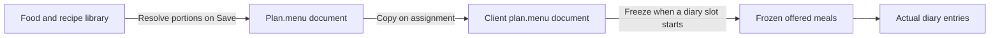

# One menu document per nutrition plan

Status: resolved

Implemented and verified in [01-menu-document.md](issues/01-menu-document.md).
Source baseline: `963f6f22`.

A nutrition plan owns one menu. The coach edits it as a whole, the server saves it
as a whole, and assignment copies it as a whole. Store that ownership directly:
one `menu` JSONB column on `nutrition_plans`.

This change removes five tables and their row reconciliation. Nutrition has eight
tables after the cutover: three Library tables, one Programming table, and four
Diary tables. Meals, day patterns, and meal choices remain product concepts inside
the menu. They have no independent persistence lifecycle.

## Storage and ownership

| Owner | Tables after the cutover | Responsibility |
| --- | --- | --- |
| Library | `nutrition_foods`, `nutrition_recipes`, `nutrition_recipe_ingredients` | Foods, recipe composition, portions, nutrient calculation |
| Programming | `nutrition_plans` | Plan details, menu, assignment, coverage |
| Diary | `nutrition_diary_slots`, `nutrition_diary_frozen_options`, `nutrition_diary_frozen_planned_items`, `nutrition_diary_entries` | Frozen offered meals and actual intake |

Plan identity, business, client, source template, revision, archive state, targets,
and coverage dates remain columns. Their foreign keys, checks, and coverage
exclusion constraint remain database guarantees. The menu contains no business IDs,
plan IDs, row timestamps, or numeric positions. Array order defines order.



## Menu shape

The public menu keeps `meals`, `day_patterns`, and `schedule`. A slot contains an
ordered `meal_ids` array. The first meal is its default choice. Replace
`options: [{id, nutrition_meal_id}]` everywhere with this array. A choice needs no
separate UUID because a meal can appear only once in a slot.

The following shape uses readable placeholders for UUIDs. The real contract
requires UUID strings.

```json
{
  "meals": [{
    "id": "meal-uuid",
    "name": "Breakfast",
    "notes": null,
    "meal_items": [{
      "id": "item-uuid",
      "kind": "food",
      "food_id": "food-uuid",
      "recipe_id": null,
      "portion": {"kind": "gram", "grams": 100}
    }]
  }],
  "day_patterns": [{
    "id": "day-uuid",
    "name": "Every day",
    "slots": [{"meal_slot": "breakfast", "meal_ids": ["meal-uuid"]}]
  }],
  "schedule": {
    "monday": "day-uuid",
    "tuesday": "day-uuid",
    "wednesday": "day-uuid",
    "thursday": "day-uuid",
    "friday": "day-uuid",
    "saturday": "day-uuid",
    "sunday": "day-uuid"
  }
}
```

The stored document adds server-resolved `weight_g` and unrounded `nutrients` to
each item. Nutrients include completeness and preserve unknown values. `weight_g`
can be null for a recipe serving without measured cooked weight. These values are
needed to freeze and scale diary nutrition without recalculating a saved menu.
The public response omits `weight_g`, adds current Library item names, and calculates
meal totals from the stored item nutrients. Rounding belongs at the HTTP boundary.

Reads and writes share one public menu shape. Item names and nutrient fields remain
accepted, optional round-trip fields on input. The server discards those supplied
values and resolves its own. The storage-only weight is never an accepted input.
Keep the established Portion union and food-or-recipe fields throughout this cutover.

## Identity and validation

Meal, item, and day-pattern IDs identify values inside one menu. Require unique
UUIDs across those nodes within that menu. IDs from another plan carry no authority
and require no database lookup. Assignment and duplication copy the document with
its IDs intact. The destination plan ID establishes a separate identity scope.

An item retains its ID when edited or moved between meals. A newly added or
duplicated item gets a new ID. Each diary reference is resolved inside its frozen
slot, so copying IDs between plans does not merge diary identities. Never resolve
a menu item globally by UUID.

Menu validation owns these rules in one place:

* At least one day pattern exists. An empty initial menu has one "Everyday"
  pattern, no meals, no slots, and all seven weekdays pointing to that pattern.
* The schedule has exactly Monday through Sunday, with a non-null pattern ID for
  every weekday. Every referenced pattern exists in this menu.
* A pattern has at most one occurrence of each permitted Meal Slot. A present
  slot has at least one meal ID, all distinct and present in this menu.
* Meals can be empty and can be shared across slots and days. Unused meals and
  unused patterns are permitted. They remain editable coach-authored content.
* IDs, field types, names, portions, and numeric limits are validated at the
  boundary. The item kind agrees with exactly one food or recipe reference.
* Referenced Library items are visible in the plan's business. Portions resolve
  against those records. Client-supplied names and nutrients grant no authority.

Authorization and the expected revision belong to Programming. Portion arithmetic
belongs to Library and its pure Portion functions. Diary owns historical rules.
Remove checks for persisted child ownership, cross-plan UUID collisions, item
parent immutability, position uniqueness, and child-row existence.

## Library changes have explicit effects

Preserve the current product behavior during this storage change:

| Action | Result |
| --- | --- |
| Rename a food or recipe | Unstarted guidance and the builder show its current name |
| Change Library nutrients or serving weights | Saved menu amounts and nutrients stay as saved |
| Save a menu | Every item resolves against the Library again; saved nutrients and resolved weights are replaced |
| Duplicate or assign a plan | Copy the saved document exactly, without recalculating nutrition |
| Start a diary slot | Freeze the offered names, amounts, and saved nutrients |
| Edit the menu or Library after a slot starts | Frozen guidance and recorded intake stay unchanged |

Names are live labels; nutrients are the coach's last saved prescription. This is
an explicit distinction. A future decision to snapshot labels or make nutrition
live would change product behavior and is not hidden inside this migration.

Programming batches name lookups through Library for the plans being returned.
Reads need no recipe ingredients or nutrient recalculation. There are no per-item
queries. The HTTP formatter receives a complete value and performs no Repo calls.

Library deletion continues to return `:in_use` for direct references in any plan,
including archived and ended plans. Food references inside recipe ingredients
remain restrictive foreign keys. A recipe's cooked weight cannot be removed while
a menu uses a gram portion of that recipe.

Programming owns tenant-scoped menu usage queries. JSONB containment finds an item
by its food or recipe ID; the gram-use query requires that same item to have a gram
portion. Use one GIN index on `menu` and the plan's tenant indexes. Do not add a
reference table, reference-ID cache, or second writable representation. Library
uses the Programming usage API for impact and deletion checks. That API only reads
plans; it never locks them or calls Library resolution.

## Save and concurrent Library mutations

`replace_menu(ctx, plan_id, expected_revision, menu)` owns one transaction:

1. Authorize the actor and lock the tenant-scoped plan row.
2. Reject an archived plan or stale revision.
3. Cast and validate the complete candidate menu.
4. Resolve its Library references under row locks held until commit.
5. Replace `plan.menu` and increment the plan revision once.

There is no diff against stored children and no sequence of child writes. A failed
step leaves the plan and its revision unchanged. Another tab saving the same
revision receives the established conflict response and retains its local draft.

Removing item foreign keys requires a deliberate concurrency replacement. Menu
writes take `FOR SHARE` locks on referenced recipes, ordered by UUID, then on foods,
ordered by UUID. The food set includes recipe ingredients used in the calculation.
Recipes are locked before their ingredient set is read. Library resolution owns
this lock-and-read path; Programming does not reach into Library schemas.

Library edits and deletes take their established exclusive row lock before usage
checks. Recipe writes acquire food locks after the recipe lock, in the same order
as menu writes. A usage check runs as a separate statement after obtaining the
lock, under the application's READ COMMITTED transaction isolation.

If a menu save wins the lock, deletion waits and then sees the committed reference.
If deletion wins, the menu save waits and then rejects the missing Library item.
The same ordering protects a recipe's cooked weight. Copies hold the source plan
lock until insertion, so its committed references continue to protect the Library
records while the destination is created. Copying does not resolve portions again.

This replaces menu-to-Library database foreign keys with transactional application
enforcement. Arbitrary SQL can bypass that enforcement. Imports and seeds must use
Programming's write path; the cutover migration is the single validated exception.
Do not recreate the five tables through JSON triggers or generic lock services.

## Elixir boundaries

Use `$elixir-patterns`: plain values, pure functions, changesets, and a transaction.
The design needs no process, cache, background job, or additional context.

* `Easy.Nutrition.Menu`, in `backend/lib/easy/nutrition/menu.ex`, owns embedded value
  types, casting, validation, reference collection, and weekday lookup. Co-locate
  small embedded types here. Their IDs are supplied explicitly; container values
  have no generated Ecto IDs. No embedded value calls Repo.
* `Plan` owns the `embeds_one :menu` JSONB field, root constraints, and pure menu
  usage query builders. A complete validated Menu value replaces the embed.
  Validation starts from an empty Menu value, so `cast_embed` does not become a
  hidden child reconciliation algorithm.
* `Programming` owns authorization, revisions, transactions, assignment, coverage,
  and menu usage reads. Duplicate and assign each insert one plan with a copied menu.
* `Library` owns batched name reads and source resolution, including the locking
  required when saving a menu. Share calculation code with its other callers.
* `Diary` and `Diary.DayAssembler` consume Menu values directly. They do not receive
  fabricated `%Meal{}` or `%MealItem{}` structs.
* `EasyWeb.Types.NutritionPlan` owns public serialization. Backend types, OpenAPI,
  generated TypeScript, and the builder use `meal_ids` in the same cutover.

Each public function has a typespec. Context functions return the repository's
tagged tuples and changeset errors. No facade, configurable persistence adapter,
parallel legacy decoder, or `.check.ts` files are introduced.

## Diary changes

Resolve a weekday through `plan.menu.schedule`, then find the pattern and its
ordered meal IDs in the document. Freeze those meal values when the slot starts.
Convert array indexes to positions only when inserting the relational frozen rows.

Remove `nutrition_diary_frozen_options.nutrition_meal_id` and its Ecto association.
Retain `source_meal_id` and `source_meal_item_id` as historical scalar UUIDs. Preserve
all frozen row IDs, snapshots, revisions, entry associations, and tenant constraints.
Diary-owned frozen option IDs remain useful: actual intake addresses those rows.
They are distinct from the menu option IDs removed by this design.

A slot already started continues to use its frozen options even if the source meal,
plan, or Library item is later deleted. A pending request carrying an item that is
no longer offered in an unstarted slot fails through the existing domain response.
It must not silently record a different item.

## One cutover

The implementation is one completed change across persistence, API, coach builder,
client guidance, tests, seeds, and documentation. Development can proceed in steps,
but the final tree has one representation and requires no follow-up cleanup.

Add a forward migration. Preserve applied migrations as executable database history.
They are not runtime compatibility code. Backfill each plan's document from ordered
child rows, preserving meal/item/pattern UUIDs, portions, stored nutrient precision,
and resolved weights. Turn each slot's ordered option rows into `meal_ids`.
Do not recalculate nutrition from the Library during migration.

Validate every backfilled plan, reference, schedule, and item count before dropping
anything. Invalid data aborts the migration with identifying information. Do not
silently discard it or manufacture empty menus. Set `menu` non-null with root shape
checks for its object and collections; nested domain validation belongs to Menu.

Remove the frozen option's live meal FK and column before dropping meal tables.
Explicitly remove `nutrition_week_schedule_complete` and
`nutrition_week_schedule_must_be_complete()`. Drop child tables in dependency order:
week schedule, meal options, meal items, day patterns, meals. Do not use broad CASCADE.
Check the database catalog for remaining dependencies before the destructive steps.

Stop application writers for the cutover. Take and verify a database backup, migrate,
then start only the matching backend and frontend builds. A rollback restores the
backup with its matching application release. Do not maintain a lossy reverse
converter or dual reads to support mixed application versions.

| Boundary | Required deletion or replacement |
| --- | --- |
| Persistence | Delete `meal.ex`, `meal_item.ex`, `day_pattern.ex`, `meal_option.ex`, and `week_schedule.ex` under `backend/lib/easy/nutrition/` |
| Menu writes | Delete `nutrition_programming_menu_replacement.ex` and all position parking, reconciliation, and child upserts |
| Plan operations | Remove child associations, `include_menu`, copy-ID maps, child insertion, and schedule rebuilding from Plan and Programming |
| Library | Replace MealItem joins for usage and cooked-weight checks with the single document query path |
| Diary | Replace relational menu traversal in `nutrition_diary.ex` and `nutrition_diary_day_assembler.ex`; remove the frozen option's live meal association |
| Contract and frontend | Remove `NutritionMealOption`, option UUID generation, `nutrition_meal_id` option fields, and option adapters; consume `meal_ids` directly |
| Fixtures and tests | Remove factories for the five deleted schemas; build plans through Programming; rewrite topology and schema assertions around behavior |
| Seeds | Update `dev_nutrition_builder.exs`, `dev_rich_client.exs`, and `backend/test/e2e/seed.exs` in the same change |
| Documentation | Update `CONTEXT.md`, `docs/nutrition-code-map.md`, and the nutrition architecture decision to describe the implemented ownership |

## Completion evidence

The implementation ticket contains the checks. Completion requires both a fresh
database build and migration of a populated database. Behavioral tests cover shared
meals, stable diary identity, exact copies, tenant isolation, atomic saves, and both
orders of concurrent menu saves and Library mutations. The browser journeys exercise
the public contract through both apps. A source audit must find no runtime use of
the five schemas, tables, or retired option representation.
