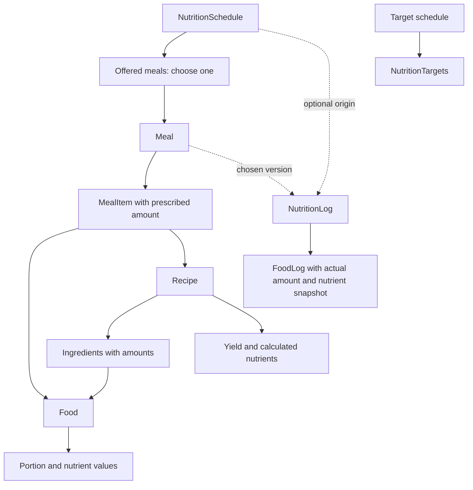

# Nutrition reference and proposed Easy model

Date: 12 October 2026.

Status: reference research complete within the access limits below. The Easy model is a proposal for review.

## Purpose and evidence

This spec uses Cronometer to clarify food selection, recipes, saved meals, targets, and intake records. It also identifies conflicts in Easy's current concept. Simplicity means that each concept has one responsibility.

Evidence has four labels:

- **Observed** means the researcher opened the authenticated web screen.
- **Network** means a browser request or response was inspected.
- **Documented** means an official Cronometer page describes the behavior.
- **Proposed** means a recommendation for Easy. It is not a Cronometer fact or an accepted project decision.

The authenticated research uses GPT-6 Astra. The account opens Cronometer Professional. The direct computer-use browser connection is unavailable. Browser CLI controls provide the UI and network inspection.

The detailed screen record is [observed-flows.md](observed-flows.md). It includes screenshot references and access limits. Endpoint evidence describes the client protocol. It does not establish Cronometer's database schema.

### Authenticated coverage

| Area | Inspected in the account | Limit |
|---|---|---|
| Diary | Personal diary, groups, date controls, day menu, water widget, nutrient summaries | No new intake was saved. |
| Food selection | Banana search, source labels, amount, measure, group, optional time | The selected food was not added to the diary. |
| Recipe | Editor, ingredient search, one draft ingredient, serving and weight modes, advanced measures, nutrient overview | Draft reverted. Cooked-weight save and history effects untested. |
| Saved meal | Editor and existing client meal's items and context menu | No edit, expansion, or delete was saved. |
| Custom food | Editor, serving and gram fields, nutrition label | No custom food saved. |
| Targets | Profile, fixed and ratio modes, energy settings, nutrient target table | No profile or target settings changed. |
| Target schedule | Weekday selectors and new-template dialog | Unsaved dialog cancelled. |
| Reports | Period controls, today and supplement inclusion, day filters | Report result is a daily average. |
| Other records | Exercise, biometric, and note dialogs | Closed without saves. |
| Professional | Shared and Internal Account forms, managed client diary, client navigation | No invitation sent. No client record changed. |
| Sharing | Friend, professional, and connected-app sections | No sharing action executed. |

The existing client had Pending Verification. Opening that client still gave access to its managed diary. Do not infer a blocked diary from that label.

Screenshot export returned an access-denied error because the browser tool's configured workspace roots exclude the requested output path. The CLI hid that error behind a success message. No authenticated screenshot is claimed. The official reference images below are clearly marked.

### Captured endpoint models

The app uses REST reads and POST calls to `/cronometer/app`. Captured POST request bodies name `getFood` and `getTotalNutrients`. Old RPC response bodies were unavailable, so their serialized model is not claimed.

The two REST response structures below were read in full through the authenticated browser. Only key names and types were saved. Account IDs, headers, cookies, tokens, and health values were omitted.

| Endpoint | Observed response | What it establishes |
|---|---|---|
| GET `/api/v3/user/{user_id}/targets` | Array of `id`, `min`, `max`, `vis`, `custom` | Numeric target values, custom status, and visibility are separate fields. |
| GET `/api/v3/user/{user_id}/food-search/string` | Array of search-result objects described below | A common search contract represents different selectable item kinds. |
| GET `/api/v3/user/{user_id}/pro/client/{client_id}/client-prefs` | Path observed. Body unavailable. | A professional client preference endpoint exists. Its fields are unverified. |

Target types in the inspected first item are `id: number`, `min: number`, `max: null`, `vis: boolean`, and `custom: boolean`. Null in this item does not establish that every maximum is null. The target table visibly has a Maximum column.

Food-search keys have these groups:

- Identity and source: `id`, `name`, `source`, `type`, `category`, `retired`.
- Item kind: `meal`, `recipe`, `recipeOrMeal`.
- Portion hints: `measureId`, `measureDisplayName`, `popularMeasureLoader`.
- Language and presentation: `language`, `translationId`, `stemName`, `displayString`, `replacementString`.
- Search rank: `score`, `globalPopularity`, `userPopularity`, `openSearchTextScore`.

The response flags support a common picker. They do not prove that Food, Recipe, and Meal use one database table. Nutrient units and nutrient-ID mappings require other evidence.

Exact sanitized evidence: [captured request models](evidence/network-models.json) and [complete REST response schemas](evidence/live-response-schemas.txt).

### Official visual references

These images come from Cronometer's help pages. They are not captures of the supplied account. Their dates and labels can differ from the inspected app.

| Image | Source and point to inspect |
|---|---|
| [Food search and portion dialog](evidence/official-add-food.png) | [Add a Food](https://support.cronometer.com/hc/en-us/articles/360018193011-Add-a-Food). Source quality, amount, measure, time, and group share one dialog. |
| [Diary calendar](evidence/official-diary-calendar.png) | [Diary Overview](https://support.cronometer.com/hc/en-us/articles/360018171731-Diary-Overview). The selected date remains explicit. |
| [Recipe serving yield](evidence/official-recipe-servings.png) | [Create Custom Recipe](https://support.cronometer.com/hc/en-us/articles/360018510311-Create-Custom-Recipe). A serving count describes the whole recipe. |
| [Cooked-weight control](evidence/official-recipe-cooked-weight.png) | [Create Custom Recipe](https://support.cronometer.com/hc/en-us/articles/360018510311-Create-Custom-Recipe). Original mass and final cooked mass have separate fields. |
| [Saved meal editor](evidence/official-meal-items.png) | [Create Custom Meal](https://support.cronometer.com/hc/en-us/articles/17687459173908-Create-Custom-Meal). The meal adds items without recipe yield controls. |
| [Report controls](evidence/official-nutrition-report.png) | [Nutrition Report](https://support.cronometer.com/hc/en-us/articles/360018569691-Nutrition-Report). Averages depend on the period and included days. |

## The concepts that must remain distinct

| Concept | Meaning | Example |
|---|---|---|
| Food | One selectable item with nutrient data and portions | Banana, cooked rice, or a supplement |
| Recipe | Ingredients, preparation, and yield for a prepared dish | A pot of lentil soup |
| Saved meal | A reusable set of items eaten together | Soup, bread, and an orange |
| Diary group | A category that organizes records | Breakfast or Supplements |
| Diary entry | An item recorded on one date, with an amount | 250 g of soup on Monday |
| Target | An intended daily nutrient amount | Protein at least 150 g |
| Target schedule | Days on which a target template applies | Training targets on Monday and Thursday |
| Repeat item | A recurring prompt to record an item | A usual breakfast or daily supplement |

Cronometer documents a saved meal as items commonly eaten together. A recipe can have several portions and a cooked weight. A diary group has its own label and organizes entries. These concepts can appear in one picker without becoming one entity. Sources: [Create Custom Meal](https://support.cronometer.com/hc/en-us/articles/17687459173908-Create-Custom-Meal), [Create Custom Recipe](https://support.cronometer.com/hc/en-us/articles/360018510311-Create-Custom-Recipe), and [Diary groups](https://cronometer.com/blog/how-to-use-diary-groups/).

For Easy, a prescribed slot adds a separate question: what can the client eat, and when? A diary category cannot answer that question.

## Cronometer flow reference

This section records documented consumer flows. Authenticated findings and differences are in the screen record. A documented flow is not counted as an executed flow.

| Flow | Documented path and behavior | Lesson for Easy |
|---|---|---|
| Open a day | Diary opens today. Date arrows and a calendar select another date. | Use the client's local date. Keep the selected date visible. |
| Add food | Add Food, search, select an item, choose quantity, serving, and group, then Add To Diary. Details show nutrients and data source. | Put search, portion, and nutrient preview in one flow. |
| Find an item again | Search has Favorites, Common Foods, Supplements, Brands, Restaurants, and Custom filters. | Start with recent items, favorites, and one search. Add filters when useful. |
| Change an entry | The amount and serving unit can be edited in the diary. Context actions include copy and delete. | Correct a recorded portion without changing its source meal. |
| Copy entries | Selected entries can be copied to another day or group. | Copy creates new intake records. It must not reuse record identity. |
| Organize a group | Select a group before Add Food, or choose the group in the entry dialog. Group actions can summarize or copy entries. | A group is independent of a reusable meal. |
| Create a food | Enter a name, a reference serving, and nutrients for that serving. Advanced nutrient fields are optional. | Make the nutrient basis explicit before data entry. |
| Create a recipe | Foods, Custom Recipes, create, add ingredient amounts, set servings or weight yield, add notes, save. | Ingredient amounts describe the whole batch. |
| Set cooked weight | Enter the measured final weight. A portion in grams uses that final weight. | Raw ingredient mass and cooked yield are different quantities. |
| Create a saved meal | Foods, Custom Meals, Create Meal, add items and their servings, save. | A meal can contain a recipe without becoming that recipe. |
| Adjust a meal in the diary | A logged meal can be opened or expanded into its component entries. | Editing this intake and editing the reusable meal need distinct actions. |
| Repeat an item | Foods, Repeat Items, pick an item, choose serving, days, group, and time. Opening a matching diary day prompts Log Items. | A recurring instruction does not prove consumption. |
| Set targets | Targets + Profile provides ratio, fixed, and keto macro modes. Ratio targets can change when the energy target changes. | Use fixed coach targets first. Avoid implicit recalculation. |
| Schedule targets | Macro Scheduler applies templates by weekday. The diary can override one day. | Targets need a schedule separate from meal timing. |
| Review nutrition | Trends, Nutrition Report shows daily averages for a chosen period. Filters include complete days and supplements. | Explain which dates and records form an average. |
| Record other data | Diary has food, exercise, biometric, and note entry actions. | A common daily view does not require one storage model. |
| Record water | A water widget records drinking water. Total water also includes food and beverages. | Drinking water and total dietary water are different metrics. |
| Share | Friend sharing covers custom foods and recipes. Professional access covers client work. | Library sharing and client-data access are different permissions. |

Sources by flow:

- Dates and entry types: [Diary Overview](https://support.cronometer.com/hc/en-us/articles/360018171731-Diary-Overview).
- Search and portions: [Add a Food](https://support.cronometer.com/hc/en-us/articles/360018193011-Add-a-Food).
- Entry corrections and copies: [Edit Diary Entries](https://support.cronometer.com/hc/en-us/articles/360018031812-Edit-Diary-Entries).
- Groups: [Diary groups](https://cronometer.com/blog/how-to-use-diary-groups/).
- Custom-food nutrient basis: [Mobile custom food](https://support.cronometer.com/hc/en-us/articles/360019866351-Mobile-Create-a-Custom-Food).
- Recipe creation: [Create Custom Recipe](https://support.cronometer.com/hc/en-us/articles/360018510311-Create-Custom-Recipe).
- Cooked yield: [Set Cooked Recipe Weight](https://support.cronometer.com/hc/en-us/articles/4406291608724-Set-Cooked-Recipe-Weight).
- Saved meals and expansion: [Create Custom Meal](https://support.cronometer.com/hc/en-us/articles/17687459173908-Create-Custom-Meal).
- Repeated entries: [Set Repeat Items](https://support.cronometer.com/hc/en-us/articles/17685528192020-Set-Repeat-Items).
- Macro modes: [Edit Macronutrient Targets](https://support.cronometer.com/hc/en-us/articles/360060119292-Edit-Macronutrient-Targets).
- Target schedule: [Macro Scheduler](https://support.cronometer.com/hc/en-us/articles/4406127050260-Macro-Scheduler).
- Reports: [Nutrition Report](https://support.cronometer.com/hc/en-us/articles/360018569691-Nutrition-Report).
- Water: [Water Tracking](https://support.cronometer.com/hc/en-us/articles/18020279636628-Water-Tracking).
- Sharing: [Sharing](https://support.cronometer.com/hc/en-us/articles/360018867471-Sharing).

### History behavior that Easy should change

Cronometer documents both Delete and Retire for a custom meal. Delete can remove diary history. Retire removes the reusable item while retaining diary records. Easy should expose Archive for a used library item. Historical intake must remain available. Source: [Create Custom Meal](https://support.cronometer.com/hc/en-us/articles/17687459173908-Create-Custom-Meal).

The official mobile Macro Scheduler guide says a template edit can affect past dates. A copied template avoids that effect. A weekday reassignment applies forward. Easy should make forward changes the default and preserve past prescriptions. Source: [Mobile Macro Scheduler](https://support.cronometer.com/hc/en-us/articles/4406120372244-Mobile-Macro-Scheduler).

### Professional flows

Cronometer documents both a Shared Profile and an Internal Profile. A shared client can record their own data. An internal profile supports professional management. Client groups organize access and shared library content. Removing a shared client ends professional access while the client's diary remains intact. Source: [Pro Client Tab](https://support.cronometer.com/hc/en-us/articles/360018673051-Pro-Client-Tab).

After invitation acceptance, a professional can open the client view, edit the diary and targets, inspect charts and reports, and write private notes. Shared snapshots and private professional notes have different visibility. Source: [Pro Client Profile](https://support.cronometer.com/hc/en-us/articles/360021494291-Pro-Client-Profile).

The professional target scheduler uses weekday templates and date-specific overrides. Professionals can restrict client changes to the scheduler. Template edits and weekday reassignment have different history behavior. Source: [Pro Client Macro Scheduler](https://support.cronometer.com/hc/en-us/articles/29627186700692-Pro-Client-Macro-Scheduler).

Custom recipes can be shared with selected clients, client groups, all current clients, or future clients. The documented sharing action is not evidence of copy-on-assignment or independent versions. Easy retains its own copy-on-assignment rule. Source: [Pro Custom Recipes](https://support.cronometer.com/hc/en-us/articles/28780966141204-Pro-Custom-Recipes).

The professional report uses a period, included-day rules, today inclusion, and supplement inclusion. Print controls choose dates and data. Easy needs clear report inputs before adding a composite adherence score. Source: [Pro Client Nutrition Report](https://support.cronometer.com/hc/en-us/articles/29625250671124-Pro-Client-Nutrition-Report).

Basic, Gold, and Professional have different access. The official subscription page lists the macro scheduler, repeat items, and recipe importer among paid functions. Exact gates encountered in this account belong in the observed record. Source: [Subscription Types](https://support.cronometer.com/hc/en-us/articles/360028026971-Subscription-Types).

## Proposed model for Easy

Retain Library, Programming, and Diary as separate responsibilities. Keep the existing copy-on-assignment principle. These recommendations refine the redesign. They do not replace the current concept without review.

### Library

| Model | Minimum responsibility | Important rule |
|---|---|---|
| Food | Name, source, brand if relevant, food or supplement classification, nutrient reference portion, available servings | A supplement uses the same nutrient and portion rules as food. |
| Serving | Label and a conversion to the food's nutrient reference portion | A named serving has a stable identity. |
| Recipe | Name, instructions, ingredient amounts, batch yield, optional measured cooked weight | It is selectable as a prepared item. Its ingredients remain a recipe responsibility. |
| Meal | Name, instructions, owner, ordered items | It has no date, time, weekday mask, or alternatives. |
| MealItem | Food or recipe reference, prescribed portion, position | It is one item in a meal. |

A Food and a Recipe can share a picker result and a resolved nutrient result. This does not require the same table. Preserve separate recipe composition and food data entry.

An ingredient is a role. A food used in a recipe is an ingredient. Avoid a separate ingredient catalogue.

A recipe can be one item in a meal. A meal has no cooked batch weight. For the first version, recipes contain foods only. Nested recipes and nested meals are deferred.

The food editor accepts the nutrient basis shown on the label. The system can normalize mass-based values to the current per-100-g form. A capsule without a known mass needs a per-serving basis. Do not invent grams to satisfy a mass-only model. Support this case through the same reference-portion contract before claiming complete supplement support.

### Programming

| Model | Responsibility |
|---|---|
| NutritionTargets | A complete named set of daily targets. An omitted nutrient has no target. |
| Target schedule | Applicable days, effective dates, and target-set version. At most one set applies per local date. |
| NutritionSchedule | Label, optional time, weekdays, effective dates, and ordered offered meals. |
| ScheduledMeal | One offered meal. One offer is fixed. Several offers mean choose one complete meal. |

Keep the accepted one-item meal rule. A scheduled banana or creatine dose uses an ordinary named meal. Do not introduce a second schedule shape for this release.

A repeating week is a view over schedules. It does not own another EatingDay entity. Selecting the same weekdays for targets and meals does not link their edit scope.

Templates are sources for copies. Client content is independent. Within one client's plan, several schedules can offer one meal. An edit to that meal affects those future offers, with the scope shown before save.

### Diary

| Model | Responsibility |
|---|---|
| NutritionLog | One actual intake occasion on a local date. Time and prescription origin are optional. |
| FoodLog | Actual food or recipe portion, resolved name, nutrient snapshot, and optional prescribed-item reference. |
| Nutrition Day view | Applicable targets, expected occasions, actual records, totals, and data completeness. |

The proposed client flow does not ask whether a banana is a "meal log" or a "food log". The same action records intake. Keep the existing `meal | food` distinction only if a defined report or workflow needs it. This is a proposed change to N12, N14, and N27.

A diary group such as Breakfast can organize records. It is not the reusable Meal and is not the schedule occurrence. Repeated labels must not merge separate intake occasions.

Recording a scheduled meal copies its current prescribed items into actual items for review. The client can change amounts, substitute, remove, or add items before save. Saving records consumption. Merely opening the day does not record consumption.

Keep an optional prescribed-item reference on a changed item. This distinguishes a substitution from an unrelated addition. Missing records mean "Not recorded", not "Skipped" or zero intake.

### Nutrient and portion rules

1. Each nutrient has one code and registered unit.
2. Unknown is different from zero. An absent value is unknown.
3. Catalogue values state their reference quantity. Actual values state the consumed quantity.
4. Convert units only when the source item has a valid conversion.
5. A generic cup-to-gram conversion is invalid. A cup of oats and a cup of milk have different masses.
6. A recipe's ingredients describe the full batch. Its output yield describes the prepared batch.
7. Portion changes scale resolved nutrients. They do not change the stored library serving.
8. Calculations retain precision. Display rounding occurs at the end.
9. Use source energy when present. Do not replace it silently with a calculation from protein, carbohydrates, and fat.
10. Intake snapshots retain the nutrient values and portion conversion used when saved.
11. Daily totals report missing nutrient data. Do not show an incomplete subtotal as complete intake.
12. Targets and prescribed totals remain separate from consumed totals.

Keep source and brand information with the selected item. A generic food and a branded product can have different data. A category is not proof of an allergy-safe item. The picker must not replace a branded selection with a generic item without the user's action.

Example: a soup batch has 1,600 kcal and a measured cooked weight of 1,200 g. A 300 g portion has 400 kcal. Four equal servings also give 400 kcal each. The raw ingredient weight does not replace the measured cooked weight.

Example: a label gives 120 kcal per 30 g. Recording 45 g gives 180 kcal. An absent iron value remains unknown after scaling.

### History and corrections

Past prescriptions must remain available even on dates without intake. A log also retains its chosen prescription version and consumed nutrient snapshot.

An explicit correction changes an intake record and retains the prior correction history. A library edit cannot silently change a saved intake. Archiving a library item cannot remove past intake or past prescription content.

The same-day boundary is still a project conflict. NU8 applies changes today. Open question 11 applies some changes tomorrow after a log claims today's occurrence. Choose one rule before implementation. The recommended rule is forward changes from today with saved logs unchanged and the changed day's prescription state visible. Do not silently apply the workout policy to nutrition.

## Conflicts in the current project

The codebase graph reports parser gaps and returned paths that no longer exist. This comparison uses direct source reads for each material claim. It is a bounded nutrition comparison, not a full repository audit.

| Conflict | Evidence | Proposed resolution |
|---|---|---|
| Recipe as food versus separate aggregates | Concept N15 says recipes are prepared foods. ADR 0002 keeps Food and Recipe separate. | Define the prepared-item behavior and retain separate Food and Recipe ownership. Use a common picker and resolver. |
| Meal items list food but do not name recipe portions | N22 and the redesign glossary describe food or supplement items. Current Library resolves both food and recipe sources. | State explicitly that a MealItem can select Food or Recipe. |
| Current day patterns versus new schedules | Implemented Content has `day_patterns` and seven schedule entries. N2 and N18 reject a stored EatingDay or permanent weekday group. | Treat these as old and new models. Plan an explicit migration after the new spec is agreed. |
| Today always changes versus a logged occurrence moves the boundary | NU8 and open question 11 use different rules. | Choose one nutrition-specific rule and define its effect on today's logged and unlogged occasions. |
| A whole target set per date versus no targets | N19 says one complete set. N1 allows meals without targets. | Use zero or one applicable target set per date. Reject overlapping target schedules. |
| Log type changes but older rules remain | N13 still names supplement logs. N27 removes that log type. | Remove superseded language. Define supplement classification on the item. |
| Shared content versus independent assignment | N26 changes every schedule offering a meal. N22 says library, program, and client copies are independent. | Explain the ownership boundary. Shared edits occur within one owner, never across assigned copies. |
| Unique daily name versus repeat intake | `DiaryMeal` has a unique name constraint per client and date. The redesign defines actual occasions. | Use record identity and optional schedule occurrence identity. Treat names as labels. |
| Amounts "only" in MealItem versus amounts in recipes and logs | N22 is about prescription. Recipe ingredients, servings, and FoodLogs also need quantities. | Say "prescribed meal amounts belong to MealItem". Do not ban other quantity roles. |
| Mass-only servings versus supplements without mass | Food servings require positive grams. Portion resolution supports grams or a grams-backed serving. | Add a reference-portion basis for discrete servings. Never manufacture a capsule mass. |

Local evidence:

- [Nutrition concept](../concept.md), N1, N13, N15, N19, N22, N26, N27, NU8, and the open questions.
- [Project glossary](../../../CONTEXT.md), implemented nutrition terms and redesign terms.
- [Nutrition ownership ADR](../../../docs/adr/0002-nutrition-module-ownership.md).
- [Current Content](../../../backend/lib/easy/nutrition_content.ex), `empty/0`.
- [Current Library](../../../backend/lib/easy/nutrition_library.ex), `resolve/3`, `portion_grams/2`, and `hydrate_recipe/2`.
- [Current Food](../../../backend/lib/easy/nutrition/food.ex), `valid_servings?/1`.
- [Current Recipe](../../../backend/lib/easy/nutrition/recipe.ex), `servings_count` and `cooked_weight_g`.
- [Current DiaryMeal](../../../backend/lib/easy/nutrition/diary_meal.ex), daily name and slot constraints.
- [Current DiaryEntry](../../../backend/lib/easy/nutrition/diary_entry.ex), portion and nutrient snapshots.
- [Current EntryResolver](../../../backend/lib/easy/nutrition_entry_resolver.ex), snapshot preservation and planned-portion scaling.
- [Current Nutrients](../../../backend/lib/easy/nutrition_nutrients.ex), unknown values and known-entry counts.

The current code already has useful rules for cooked recipe yield, frozen intake values, and unknown nutrients. Retain those rules.

## Proposed product flows

### Client records intake

1. Open Today or select a date.
2. Select a prescribed occasion or Add food.
3. Search recent items, favorites, or the catalogue.
4. Select a food, recipe, or saved meal.
5. Review actual portions and nutrient values.
6. Save the intake.
7. Show the updated totals and an Undo action.

A prescribed occasion with alternatives shows the complete choices first. Selecting one pre-fills actual items. A saved meal expands into editable actual items. A recipe stays one portion unless the user explicitly adjusts its ingredients.

### Coach prescribes a week

1. Open the client's nutrition week.
2. Choose targets for each applicable weekday.
3. Add a schedule and select a meal.
4. Add complete alternatives if required.
5. Set weekdays, an optional time, and a label.
6. Review the edit scope and save.

Keep days and alternatives in the week editor. Keep ingredients and portions in the meal editor. The save action names every affected schedule, as NU7 already requires.

### Coach reviews intake

1. Select a date or a period.
2. View prescribed and consumed values separately.
3. Open an occasion to inspect actual portions and substitutions.
4. Read missing-data indicators before interpreting nutrient totals.
5. View an average with its included dates and denominator.

The first report uses dates with saved intake and identifies excluded empty dates. Today is excluded by default from a completed-period average. Do not interpret an empty date as a zero-intake date.

## Release scope

| Build first | Defer |
|---|---|
| One food and recipe picker with recent items and favorites | Barcode scanning, label OCR, photo recognition, and voice input |
| Food reference portions and valid serving conversions | Automatic nutrient enrichment and external food submission |
| Recipes with ingredient amounts, servings, and cooked yield | Nested recipes and recipe import |
| Meals with foods and recipe portions | Nested meals and meal-level cooked yield |
| Weekly schedules and complete meal alternatives | Date-specific replacement UI |
| Fixed explicit daily targets with existing four target forms | Ratio, keto, and expenditure-based target engines |
| Actual portions, substitutions, free intake, and corrections | Automatic consumption from schedules |
| Daily totals and a clear period average | Nutrition scores, nutrient ratios, and Oracle suggestions |
| Existing coaching permissions and copy-on-assignment | Friend sharing and external device connections |

Use existing Tracker concepts for body measurements. Use existing workout concepts for exercise. Keep water optional until the drinking-water rule and duplicate-record behavior are defined.

## Acceptance examples for the next design

These are specification examples, not tests added to the codebase.

| Scenario | Required result |
|---|---|
| A client records a banana without a plan | One intake is saved. No reusable meal or schedule is created. |
| A coach prescribes creatine alone | One ordinary one-item meal is offered. The client sees the item and dose. |
| A meal contains soup and bread | Soup uses its recipe portion. Bread uses its food portion. No second soup nutrient count is added. |
| A recipe has four servings and a known cooked weight | Count-based and weight-based portions produce consistent nutrient totals. |
| A client changes 100 g to 150 g | Actual nutrients scale by 1.5. The prescription remains 100 g. |
| A client substitutes rice for toast | The record shows the consumed rice and retains the prescribed-item origin. |
| A schedule offers two meals | Choosing one records only that meal. |
| A coach edits the source library meal | Existing client copies remain unchanged. |
| A coach edits a shared client meal | The save identifies all affected future schedules. Past prescriptions remain available. |
| No intake was saved yesterday | Yesterday's prescription is still reconstructible. Intake reads Not recorded. |
| A library item is archived | Past prescriptions and intake snapshots still display the item. |
| One entry lacks iron data | The day does not show a complete iron total. |
| A target schedule has no entry for Sunday | Sunday has no targets. Other days retain theirs. |
| Two actual occasions use the label Snack | Both records remain distinct. |

## Decisions required before implementation

1. Confirm that MealItem explicitly accepts both Food and Recipe.
2. Confirm the reference-portion rule for supplements without a known mass.
3. Decide whether `NutritionLog.type` has a required product meaning.
4. Resolve the same-day prescription edit boundary.
5. Select history storage after the behavior is agreed. Preserve past applied prescriptions, including unlogged dates.

This research does not change implementation, accepted concept decisions, or the glossary.
