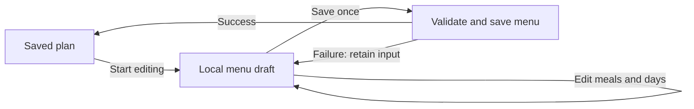

# Nutrition: where the behavior lives

A coach builds a menu. A client records what they ate. The coach reviews the diary.

## Coach menu editor

The editor has a saved plan and, while editing, one private draft. Every edit changes
that draft synchronously. Save submits the complete menu; Discard reloads the saved
plan. A failed save or reload leaves the draft intact. Background query errors keep the
editor mounted while cached data exists. A revision conflict asks the coach to
reload instead of silently merging changes or replacing their input.



Read the editor in this order:

1. [menu.ts](../frontend/apps/coachapp-v2/src/library/nutrition-plans/builder/menu.ts)
   edits the API's `NutritionMenu` directly. Meals contain items. Day patterns contain
   slots and ordered meals. The week schedule points to day patterns. Array
   order is authoritative. Meals, items, and days keep their UUIDs through saves.
   Each slot contains ordered `meal_ids`; a choice needs no separate UUID.
2. [plan-builder.tsx](../frontend/apps/coachapp-v2/src/library/nutrition-plans/builder/plan-builder.tsx)
   owns the draft, Save, Discard, navigation protection, and the active editor. The
   query cache contains saved server data. It is never patched while typing.
3. [nutrition-plans.ts](../frontend/apps/coachapp-v2/src/api/nutrition-plans.ts)
   sends `{expected_revision, menu}` to `PUT /v1/coach/nutrition-plans/{id}/menu`
   and updates affected queries after success. The response is the complete saved
   plan, including the same `menu` structure and calculated nutrition.

The public contract is in
[nutrition_plan.ex](../backend/lib/easy_web/types/nutrition_plan.ex).
`NutritionMenu` is shared by reads and writes. Database positions, parent IDs, and
row timestamps stay on the server. Item names and nutrient totals are optional on
input and supplied by the server; sending a read response back does not make these
values authoritative. Gram portions use `grams`; serving portions use `amount`,
`unit`, and `label`. The server resolves serving weights.

The server requires at least one day, a complete week schedule, valid meal
references, and unique UUIDs. It checks the plan revision and saves everything in
one transaction. UUIDs identify values within a menu. A copied menu retains those
IDs under its own plan ID, and editing one copy never changes another. Foods and
recipes are resolved in the coach's business scope. Archived plans are read-only.

The other builder components render controls or collect input. They report local
edits; they do not decide when to send requests, retry, undo, or refetch.

Amount entry has one unit and one positive value. Done applies that amount to the
draft. Nutrients are calculated by the server on Save; the editor hides saved totals
while the draft has changes. This deliberately gives up live nutrient previews.
Coverage dates, plan details, and targets are edited together on the plan details
form. Assignment and lifecycle actions are unavailable while menu edits are pending.

The editor retains meals shared across days and alternative meals. Deleting
a day transfers its weekdays to a remaining day and keeps its meals. Deleting a meal
removes its uses throughout the menu. These are product rules, located in `editMenu`.

## Menu persistence

[Plan](../backend/lib/easy/nutrition/plan.ex) stores one embedded
[Menu](../backend/lib/easy/nutrition/menu.ex) as JSONB. Plan details, ownership,
revision, targets, and coverage dates remain columns. Nutrition has six tables:
three for the Library, one for Programming, and two for the Diary.
`nutrition_diary_days` owns the targets frozen once for each client date.

Menu owns casting, internal references, ordering, and schedule validation.
Programming locks the plan, checks its revision, resolves Library portions, and
replaces the complete document. Assignment and duplication copy its structure, Library references, and chosen
portions without remapping node IDs. There are no child menu
tables, position updates, or row reconciliation.

Menu Items store a Food or Recipe ID and the chosen Portion. Names, serving weights,
and nutrients all resolve from the current Library on reads. Recipe ingredients
also resolve named serving weights from the current Food. Library changes therefore
update menus without another Save. Started Diary slots keep their frozen names,
portions, and nutrients.

Reads that resolve menus or recipes use one repeatable-read database snapshot, so a concurrent Library
edit cannot mix old recipe servings with new ingredients or remove an item halfway
through a menu read. These reads do not lock Library rows. Writes load recipes,
ingredients, and foods once, taking recipe then food locks; they do not fetch media
to calculate nutrients.

Library resolution returns a map keyed by source and chosen portion. Each menu item
looks up its own result; plans do not count or split a shared result list. Repeated
references share a calculation, while different portions remain distinct. Recipe
ingredients retain their requested order when consuming these results.

Library usage queries search plan documents through one GIN index. A referenced
food or recipe cannot be deleted, including when an archived plan uses it. Recipe
gram portions prevent removal of the recipe's cooked weight. Referenced Food serving
identities cannot be removed, but their weights may change. Menu saves lock
recipes, then foods, in UUID order until commit; Library mutations lock their row
before checking usage. These locks protect the references against concurrent
deletion. Recipe ingredient foreign keys remain in the database.

The [menu document decision](adr/0003-nutrition-menu-document.md) records the
storage tradeoff and deployment requirements.

## Assignment and coverage

Pick a client, choose dates, then assign. The default start comes from the server’s
`Client.local_date`. Coverage and Programming queues use the same client calendar,
with business timezone fallback. Existing plan names do not block the
picker: the database rejects overlapping date ranges. A copied client plan has
its own menu and revision.

`GET /v1/coach/clients/{id}/nutrition-coverage` returns the client's local `date`,
one `current` plan or null, and `upcoming` plans ordered by start date. The coach
screen renders those fields directly. It never treats the first unarchived plan
as current. “End after today” updates `end_date`; archive remains a separate action.
Coverage includes both its start and end dates. Parent screens own assignment
dialog visibility; the dialog has no second internal open state.

## Library editing and portions

Food, recipe, and plan details forms keep their initial entity and revision together.
Background refreshes cannot advance the revision underneath an unfinished form.
Conflicts retain input. Only an explicit, successful Discard and reload replaces it.

[RecipeForm](../frontend/apps/coachapp-v2/src/library/recipes/recipe-form.tsx) owns
one form containing details and the ordered ingredients. Ingredients use the same
form control, validation, and dirty state. Each ingredient is `{food_id, portion}`. A portion is grams or a named serving;
the server resolves its weight. Serving buttons select that portion directly;
there are no ingredient subforms, selection maps, forced remounts, or live nutrient
calculations. Save submits the whole ingredient array. Missing ingredients are
reported instead of silently dropped.

[FoodForm](../frontend/apps/coachapp-v2/src/library/foods/food-form.tsx) likewise
owns details and serving sizes. Serving labels, units, amounts, gram weights, and
the chosen default are preserved on save. A serving is edited directly in the form,
with no intermediate add form or read/write representation converter.

[Portions](../backend/lib/easy/nutrition_portions.ex) defines `default_portion` and
`portion_options` for foods and recipes. Both apps use these returned portions.
The generated `NutritionPortion` is a union: `{kind: "gram", grams}` or
`{kind: "serving", amount, unit, label}`. Read and write use the same shape;
there are no nullable sibling fields or frontend conversion adapters. Recipes
always support servings; grams require a measured cooked weight. Menu, recipe ingredient,
and diary writes send the chosen portion; the backend resolves weights and nutrition.

Foods have one `media_id`. Media can be an uploaded asset or an external system
image; both return the same media object. The migration preserves existing food
images. CSV seeds create the system Library once, atomically; they are not an import
synchronization API.

## Client diary

The server returns ready-to-render rows. Each row has its name, portion, nutrients,
status, and nullable `entry_id`. Pending rows have no entry. Only the slot has a
revision: zero before its first save, then increasing after every successful save.
The assembler builds and rounds this shape directly. There is no second HTTP
formatter rebuilding it. Portions retain their original precision.

[Nutrition Today](../frontend/apps/clientapp-v2/src/nutrition/nutrition-today.tsx)
owns the open editor and all saves. The amount sheet collects an amount and notes.
The editor captures the slot and its revision when opened, so a background refresh
cannot silently replace the baseline of an unfinished edit.

Every write uses `PATCH /v1/client/nutrition-days/{date}`:

```json
{"slots": [{"meal_slot": "breakfast", "meal_id": null,
  "expected_revision": 0, "entries": []}]}
```

Each supplied slot contains its complete actual intake. Omitted slots stay unchanged;
omitted entries in a supplied slot are deleted. Entries contain `id`,
`planned_item_ref`, `food_id`, `recipe_id`, `portion`, and `notes`. A new entry gets a
UUID from the client. `planned_item_ref` links it to an offered item; null means extra
intake. Notes are explicit, including null to clear them.

Entry IDs belong to their slot. Reusing an ID in another slot creates an independent
entry there. Array order is authoritative for choices, their planned items, and
actual intake. Displayed planned rows follow the selected meal; extras follow intake
order. Choice and planned-item IDs retain the original Menu UUIDs.

Log a row, edit its amount, replace food, undo, log a whole meal, change the meal
choice, or log the rest of the day: each action constructs the desired slots and
calls the same save. The backend locks slots in a consistent order and saves all
supplied slots in one transaction. Any stale revision or invalid entry rolls back
all of them. The transaction also uses one repeatable-read snapshot, so Library
edits cannot mix versions inside frozen intake. A database serialization conflict
rolls back the complete save and returns the existing 409 conflict response. This
can also happen for concurrent saves of different slots sharing day or activity
state. Empty saved slots remain, retaining the revision after deletion.

`Repo.snapshot` owns transaction rollback and serialization-conflict translation.
Diary operations return success or an error directly. Malformed drafts, including
repeated slots, entry IDs, and planned references, return 422; stale revisions and
serialization races return 409.

There are no request keys, response replay records, or cleanup workers. A retry
with a revision already saved receives a conflict. After any error the API hook
refreshes the day; an open editor keeps its original revision. Close and reopen to
edit the latest version. Successful responses update cached days before refetching.

[DiarySlot](../backend/lib/easy/nutrition/diary_slot.ex) stores one JSONB document
containing `meal_id`, `options`, and `entries`. Its co-located embedded values own
snapshot validation and planned-reference interpretation. Each save builds the
complete desired intake and writes the slot once. There are no child Diary tables,
child-row locks, preloads, or reconciliation. Day targets remain in DiaryDay.

[Diary](../backend/lib/easy/nutrition_diary.ex) owns correction eligibility, frozen
guidance, transactions, and nutrient scaling. Same-food edits scale frozen
nutrition. Switching serving units resolves only the new weight through the
permitted library, then scales the frozen nutrition basis. Corrections in a stored
unit still work after library deletion. Replacement foods resolve fresh nutrition. Switching the
offered meal preserves existing intake. Past days never reconstruct old guidance
from today's plan. Correction deadlines use the timezone frozen with each slot.

Database migrations repair missing historical planned-item identities and recipe
serving units before enforcing the new constraints. No runtime legacy fallback is
needed. Frozen planned references remain stable after menu or library deletion.

Day targets freeze on the first successful slot save and are shared by every slot
on that date. Starting a later slot does not replace them with edited plan targets.
Diary items and entries retain one scalar Food or Recipe ID with no Library foreign
key. Reads check source availability and hide deleted links, while frozen names and
nutrients remain usable. Item kind comes from its source ID; nutrient completeness
comes from the five nutrient values. Neither is a persisted flag.

[DayAssembler](../backend/lib/easy/nutrition_diary_day_assembler.ex) converts live
Menu meals into the same slot document used by stored history. One renderer builds
both kinds of slot. The [slot document decision](adr/0005-nutrition-diary-slot-document.md)
records the storage boundary and migration requirements.

The contract lives in [day.ex](../backend/lib/easy_web/types/nutrition/day.ex).

## API boundaries

Edits require `expected_revision`: menu, plan details, Food, Recipe, and Diary slots.
Duplicate, assign, archive, restore, and delete do not. Plan responses expose one
`lifecycle`; `archived_at` remains an internal storage field. Nutrition Day lists
return every date in a range of at most 31 days, with no pagination or count.

Typed routes reject unknown keys, malformed UUIDs, and invalid dates with 422 before contexts run.
Every supplied date parameter is validated, including `from` or `to` beside an exact `date`.
Response type assertions run in development and test; production omits that walk.
Both frontend contracts are generated from the backend types. Food and Recipe edits
invalidate dependent Library, plan, coverage, and Diary queries.

## Server responsibilities

* [Library](../backend/lib/easy/nutrition_library.ex) owns foods, recipes, reference
  availability, and loading their current values.
* [Portions](../backend/lib/easy/nutrition_portions.ex) resolves portions, and
  [NutrientTotals](../backend/lib/easy/nutrition_nutrient_totals.ex) calculates nutrients.
  Each is one map representation used by menus, ingredients, and Diary storage.
* [Programming](../backend/lib/easy/nutrition_programming.ex) owns templates,
  independent client plans, assignment, and coverage.
* [Menu](../backend/lib/easy/nutrition/menu.ex) owns the embedded values and pure
  validation. Programming persists the complete value in one transaction.
* [Diary](../backend/lib/easy/nutrition_diary.ex) preserves offered guidance when a
  slot starts and records actual intake. Later plan edits cannot rewrite that history.

## Tests

Run `rtk proxy just test-e2e` from the repo root for the real coach/client journeys.
Install dependencies with `rtk proxy just setup` and install the browser once with
`rtk proxy pnpm -C frontend exec playwright install chromium`. Local Postgres must
be running with the connection configured in `backend/config/test.exs`.

The command recreates only `easy_test_e2e`, migrates it, seeds separate confirmed
coaches and clients per scenario, builds both apps, and starts Phoenix on 4400,
coach on 2421, and client on 2414. Those ports must be free. Playwright stops its
servers when the run finishes. Test mail stays local; OTP is `123456`.

[The five journeys](../frontend/e2e/nutrition.browser.mjs) cover food/recipe/menu
creation, assignment and logging, intake corrections, concurrent menu saves with
failed reload recovery, and frozen diary data after library/menu edits. Each runs
with the coach at 375px and 1280px; the client stays at 375px. Login and successful
API calls use the real server. Only the failed-refresh case interrupts a request.
Service workers are blocked for predictable request interception, so this suite
does not verify PWA installation or offline caching.

Use `rtk proxy just test-e2e --project=375` for one coach width, or add
`--grep 'concurrent'` to run one journey. Failures retain screenshots and traces
under `frontend/e2e/test-results/`. Open the report with
`rtk proxy pnpm -C frontend exec playwright show-report e2e/playwright-report`.
Generated fixtures, builds, and browser artifacts are ignored by git.

Behavior suites live under each app's `tests/nutrition/`. Run an app's `check` script
for its unit suites. They cover product behavior and failures across operations,
without requiring a test file beside each helper.

With the coach dev server running, execute
`rtk node frontend/apps/coachapp-v2/tests/nutrition/builder.browser.mjs` from the repo
root. It renders the actual builder against controlled HTTP responses at 375px and
1280px. It checks local edits, Save failures and retries, revision conflicts, Discard,
navigation protection, stable identities, meal creation/reuse, and day deletion.
It also covers failed refreshes and explicit reloads without draft loss. This is browser coverage of
the frontend; it is not an end-to-end database test.

With both app dev servers running, execute
`rtk proxy node frontend/apps/clientapp-v2/tests/nutrition/diary.browser.mjs`.
It exercises the client diary at 375px: actual portion on first log, failed-save
retry, failed refresh with amount/notes retention, returned-day rendering, pending-row logging, edits, replacement, undo, and
extra-food retry. It also checks coach diary rendering at 375px and 1280px.
Controlled HTTP responses cover frontend behavior; backend router tests separately
verify persisted portions, revisions, tenant isolation, and frozen nutrients.

Library and assignment scenarios run with
`rtk proxy node frontend/apps/coachapp-v2/tests/nutrition/library-and-coverage.browser.mjs`.
At both coach widths they verify ingredient validation/reordering, failed-save
recovery, serving metadata round trips, default selection, current/upcoming plans,
ending by date, server-owned assignment defaults, and assigning to a client with
an existing plan. Food and recipe edits include concurrent revision changes,
failed reloads, and explicit recovery.
