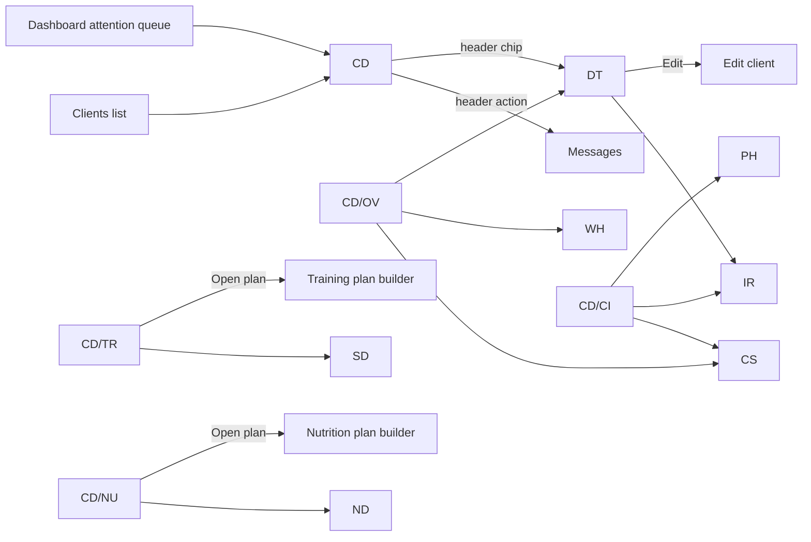

# Client detail — full UX specification

Date: 2026-07-21
Status: approved for design
Scope: the coach-facing client detail hub and every screen reachable from it. This fills the gap named in `design-handoff/GAPS.md` ("Client detail screen — linked from CL/DB but not designed").

This document is written for a UI designer. Every screen lists its zones, exact copy, data bindings, formats, interactions, and states. Where a value is computed rather than fetched, the formula is given. Component names refer to `design-handoff/UI-CONTRACT.md` (HeroUI v3 vocabulary); the designer designs to those primitives, the engineer maps 1:1.

Design principle (from competitive research on TrueCoach, Everfit, Trainerize, CoachRx, PT Distinction): triage lives on the clients list and dashboard; this screen is depth. A coach arrives here already knowing *why* (a flag, an unread message, a submitted check-in). The screen answers "what happened, and what do I change" with at most one level of tabs. The most-cited failure in competitor apps is data buried in submenus — nothing here is more than 2 taps from the header.

---

## 0. Screen inventory and navigation map

| ID | Screen | Route | Type |
|----|--------|-------|------|
| CD | Client detail shell (header + stat strip + tabs) | `/clients/:id` | Page |
| CD/OV | Overview tab | `/clients/:id` (default tab) | Tab panel |
| CD/TR | Training tab | `/clients/:id?tab=training` | Tab panel |
| CD/NU | Nutrition tab | `/clients/:id?tab=nutrition` | Tab panel |
| CD/CI | Check-ins tab | `/clients/:id?tab=check-ins` | Tab panel |
| SD | Session detail | `/clients/:id/sessions/:sessionId` (exists) | Page |
| ND | Nutrition day detail | `/clients/:id/nutrition/:date` | Page |
| CS | Check-in submission detail | `/clients/:id/check-ins/:assignmentId` | Page |
| PH | Progress photos | `/clients/:id/photos` | Page |
| WH | Weight history | `/clients/:id/weight` | Page |
| DT | Client details and settings | `/clients/:id/details` | Page |
| IR | Intake responses | `/clients/:id/intake` | Page |
| — | Messages | `/clients/:id/messages` (exists, unchanged) | Page |
| — | Edit client | `/clients/:id/edit` (exists, unchanged) | Page |



Back behavior: every sub-screen (SD, ND, CS, PH, WH, DT, IR) is a focused page with `BackButton` returning to the tab it came from (preserve `?tab=` in the return route). On mobile these pages hide the app bottom nav, matching the pattern set in the library list screens.

---

## 1. Global rules (apply everywhere in this spec)

### 1.1 Formats

| Value | Rule | Example |
|-------|------|---------|
| Date, current year | `D MMM` | `15 Jul` |
| Date, other year | `D MMM YYYY` | `15 Jul 2025` |
| Date within last/next 7 days, in lists | Weekday prefix: `ddd D MMM` | `Mon 13 Jul` |
| Relative time (activity, messages) | `Today`, `Yesterday`, `{n}d ago` up to 7 days, then absolute date | `3d ago` |
| Time | 12-hour, lowercase meridiem | `6:42 pm` |
| Weight | 1 decimal, space before unit | `72.4 kg` |
| Calories | Integer, thousands separator, unit `kcal` | `1,850 kcal` |
| Macros | Integer grams | `160 g` |
| Percentage | Integer, no space | `80%` |
| Duration | `{h}h {m}m`, omit zero hour | `1h 12m`, `48m` |
| Client name | `{first_name} {last_name}`; avatar fallback = first letters of first and last name | `Priya Sharma` / `PS` |
| Truncation | Names and single-line labels truncate with ellipsis at 1 line; notes and answers wrap freely | |

Units come from the data (`kg`/`lbs` on weight entries, load units on sets). Never convert; display what was logged.

### 1.2 Enum → display copy (exact strings)

| Backend value | Display |
|---------------|---------|
| Client `status: pending` | Chip `Invited`, soft warning |
| Client `status: active` | Chip `Active`, soft success |
| Client `status: inactive` | Chip `Inactive`, soft default |
| `inactive_reason: subscription_expired` | Alert copy, see §8 |
| `inactive_reason: awaiting_seat` | Alert copy, see §8 |
| Client `stage: onboarding` | Chip `Onboarding`, outline |
| Client `stage: coaching` | (no chip — coaching is the normal state; absence of `Onboarding` implies it) |
| Session `state: completed` | Chip `Completed`, soft success |
| Session `state: active` | Chip `In progress`, soft warning |
| Session `state: discarded` | Chip `Discarded`, soft default |
| Set `set_type: warmup` | Chip `Warm-up`, outline, sm |
| Set `set_type: dropset` | Chip `Drop set`, outline, sm |
| Set `set_type: working` | (no chip) |
| Load unit `bodyweight` | `BW` |
| Load unit `none` | `—` |
| Food log `source: planned` | (no chip) |
| Food log `source: replacement` | Chip `Swapped`, outline, sm |
| Food log `source: unplanned` | Chip `Added`, outline, sm |
| Meal slots | `Breakfast`, `Morning snack`, `Lunch`, `Afternoon snack`, `Dinner`, `Evening snack` |
| Assignment `status: assigned` | Chip `Due {due_date}`, outline |
| Assignment `status: in_progress` | Chip `In progress`, soft warning |
| Assignment `status: completed` | Chip `Submitted {completed_at}`, soft success |
| Assignment `status: missed` | Chip `Missed`, soft danger |
| Assignment `status: dismissed` | Chip `Dismissed`, soft default |
| Check-in frequency | `Once`, `Weekly`, `Every 2 weeks`, `Monthly` |
| Submission unreviewed (`reviewed_at` null) | Chip `Needs review`, soft warning |
| Submission reviewed | Chip `Reviewed`, outline |

### 1.3 Loading, empty, error (every card and page)

* First load of CD: `PageSkeleton`. Never a centered spinner.
* Each tab panel and each card loads independently with `ListSkeleton` shaped like its content.
* Page-level fetch failure (client itself): `ErrorState` with `Retry`.
* Card-level fetch failure: soft danger `Alert` inside the card, copy `Couldn't load {section}.` with a `Retry` link. Section names: `training`, `nutrition`, `check-ins`, `weight`, `messages`.
* Empty states are specified per section below; every one has a next action, none is a dead end.

### 1.4 Responsive

Two reference widths: 375px (mobile) and 1280px (desktop).

* Mobile: single column, stat strip is a 2×2 grid, tabs are the underline `Tabs` variant, full-bleed lists.
* Desktop: content max-width container; stat strip is 4-across; tab panels lay out as noted per screen. Sub-screens stay focused pages on both breakpoints (no popover/modal versions), except where a sheet is named explicitly.
* All overlays: `Popover` desktop / `KeyboardSheet` mobile. Confirms are `AlertDialog` on both.

---

## 2. CD — client detail shell

The shell renders for every client status; what appears inside varies by status (§8). The shell has three zones stacked: header, stat strip, tabs.

### 2.1 Header

Mobile layout, top to bottom; desktop is the same content in one row (avatar left, text block center-left, actions right).

```
[← back]                                    [⋯ menu]
[Avatar 56px]  Priya Sharma
               [Active] [Onboarding] [chips…]
[Attention chips row — only when flags are true]
[ Message (n) ]  [ Call ]  [ WhatsApp ]
```

* Back: `BackButton`, returns to clients list (or dashboard if that was the referrer).
* Avatar: initials fallback, 56px mobile / 64px desktop.
* Name: `Typography` page-title size, 1 line, truncates.
* Status chip row: status chip (§1.2), then `Onboarding` chip when `stage = onboarding`. Nothing else here — this row is identity, not alerts.
* Attention chips row (only chips whose flag is true; row hidden when none). Source: `intake_incomplete`, `needs_plan`, `expiring_soon` on `GET /v1/coach/clients/:id`. All are tappable:
  * `intake_incomplete` → chip `Intake pending`, soft warning → navigates to CD/CI scrolled to the intake section.
  * `needs_plan` → chip `No active plan`, soft warning → navigates to CD/TR (which shows the assign-plan empty state).
  * `expiring_soon` → chip `Expires {subscription_ends_on}`, soft danger → navigates to DT scrolled to Subscription.
* Actions row, three buttons:
  * `Message` — primary variant, `MessageCircle` icon, with a `Badge` count when `unread_count > 0` from `GET /v1/coach/clients/:id/conversation`. Navigates to Messages. This is the most-used action on the screen; it is always the visually dominant button.
  * `Call` — secondary, `Phone` icon, `tel:` link using `client.phone`. Hidden when `phone` is empty.
  * `WhatsApp` — secondary, WhatsApp glyph from the existing implementation, `wa.me` link. Hidden when `phone` is empty.
* `⋯` menu (`Dropdown`): items `Edit client` (→ edit page), `Details & settings` (→ DT), and for active clients `Deactivate client` (danger item, see DT §7.5 for the confirm). For pending clients the menu instead holds `Resend invite` and `Revoke invite` (danger).

### 2.2 Stat strip

Four stat tiles (`Card`, compact). Mobile 2×2, desktop 4-across. Each tile: small muted label, large value, small sub-line. Rendered only for `status = active` clients (see §8 for other statuses). Not tappable except where noted.

Tile 1 — `Workouts`
* Value: `{completed} of {scheduled}` — completed = `TrainingSession` records with `state = completed` and `date` in the last 7 calendar days (today inclusive); scheduled = number of schedule entries per week on the active training plan. The `of` phrasing is deliberate — a bare `3/5` reads as a fraction or a date to non-technical coaches.
* Sub-line: `last 7 days`.
* If completed < scheduled − 1 (two or more behind), value renders in danger color with a `TrendingDown` icon — this is the drop indicator; competitor research shows the drop signal matters more than the number.
* No active plan: value `—`, sub-line `No plan`.

Tile 2 — `Meals logged`
* Value: `{logged} of 7 days` — a day counts as logged when any meal log for that date has `logged_calories > 0`. Window: last 7 calendar days.
* Sub-line: average of `logged_calories` summed per logged day, as `avg 1,910 kcal a day`.
* No active nutrition plan: value `—`, sub-line `No plan`.

Tile 3 — `Weight`
* Value: latest `WeightEntry` as `72.4 kg`.
* Sub-line: delta vs the nearest entry ≥ 28 days older: `▼ 1.2 kg in 4 weeks` or `▲ 0.8 kg in 4 weeks`. Delta color: success when moving toward `goal_weight_value`, danger when moving away, muted when no goal is set or fewer than 2 entries exist.
* No entries: value `—`, sub-line `No entries`.
* Tapping the tile opens WH.

Tile 4 — `Last active`
* Value: relative time (§1.1) of the most recent of: latest completed session's `date`, latest meal-log date with logging, latest form submission `submitted_at`, latest client-sent chat message.
* Sub-line: names the source: `workout`, `meal log`, `check-in`, `message`.
* ≥ 7 days: value renders in danger color. Never active: value `—`, sub-line `No activity yet`.

Computation note for engineering: all four tiles are computable from endpoints that already exist (sessions, meal logs, weight entries, form submissions, conversation). No new backend work.

### 2.3 Tabs

`Tabs` component, labels exactly: `Overview` · `Training` · `Nutrition` · `Check-ins`. Overview is default. Selected tab persists in the `?tab=` query param so back-navigation restores it. Mobile: underline tabs, horizontally fixed (4 fit at 375px). Desktop: same tabs above the panel area.

---

## 3. CD/OV — Overview tab

Purpose: catch up on this client in under 30 seconds. Order is fixed; cards render top to bottom (mobile) / two columns (desktop: left = review card, week strip, weight; right = notes, details link).

### 3.1 Needs-review card (conditional, always first when present)

Rendered when the client has any completed check-in submission with `reviewed_at = null`.

* `Card` with soft warning tint. Title: `Check-in to review`. Body line: `{template name} · submitted {relative time}`.
* Primary button `Review` → CS for that submission. If several are unreviewed, the card shows the newest and the body gains a second line `+{n} older unreviewed`.

### 3.2 This-week strip

`Card`, title `This week`. Seven day columns, rolling window ending today, today rightmost. Each column: weekday initial (`M T W T F S S` pattern, actual initials of the dates), day number, and two stacked dots:

The two dot rows are labeled at the left edge in small muted text: `Workouts` and `Meals`. The labels replace any legend — a coach reads the strip like a sentence, no decoding.

* `Workouts` row: filled success = a completed session exists that date; filled danger = a schedule entry existed for that weekday but no session (missed); hollow muted = rest day (nothing scheduled); ring outline = a session is in progress.
* `Meals` row: filled success = day logged (per the Meals-logged tile rule); hollow muted = not logged; the whole row is hidden when the client has no active nutrition plan.

No legend row. The strip is not interactive (glanceable only); the Training and Nutrition tabs are the drill-down.

### 3.3 Latest check-in card

Rendered when at least one completed check-in submission exists.

* Title: `Latest check-in`. Sub: `{template name} · {submitted date}`.
* Body summarizes up to three answers, in the template's question order, picking only these types: each `rating` answer as `{question label} {value}/5`, a `weight` answer as `Weight 72.4 kg`, and photo answers as a row of square thumbnails (max 4, 64px, rounded).
* Footer: chip `Reviewed` or `Needs review` (§1.2) + link `View check-in` → CS.
* If no check-in has ever been submitted but a schedule exists: replace body with muted text `Next check-in {next_due_on}`. If no schedule either: this card is absent (the Check-ins tab owns setup).

### 3.4 Weight card

* Title `Weight`, value row `72.4 kg` + the same delta chip as Tile 3.
* Sparkline: last 90 days of weight entries, no axes, single line, dot on last point. If `goal_weight_value` is set, a dashed horizontal goal line with a right-aligned tiny label `goal 68 kg`.
* Footer link `All entries` → WH.
* Empty (no entries): muted text `No weight logged yet. Weight arrives from check-ins or the client app.` No button (coaches don't log client weight here).

### 3.5 Notes card

* Title `Notes`. Inline-editable multi-line text bound to `client.notes` (the existing `InlineNotes` behavior: tap to edit, save on blur, PATCH client). Placeholder: `Add private notes about this client…`. Helper caption under the field: `Only you and your team can see notes.`
* Toast on save: `Notes saved`.

### 3.6 Details row

A single `ListBox`-style row at the bottom: label `Details & settings`, sub-line `Subscription, coach, intake, invitation`, chevron. → DT.

---

## 4. CD/TR — Training tab

### 4.1 Active plan card

Data: `GET /v1/coach/clients/:id/training-plans`, the plan with `status = active`.

* Title: plan name. Sub-line: `{start_date} – {end_date}` (or `Started {start_date}` when end is null).
* Buttons: `Open plan` (secondary → training plan builder for this plan), `⋯` menu with `Change plan` (opens the existing assign-plan flow) and `End plan` (existing archive behavior, `AlertDialog` confirm: title `End this plan?`, body `The client will no longer see scheduled workouts.`, confirm `End plan` danger, cancel `Keep plan`).
* Empty (no active plan): `Card` empty state — icon `Dumbbell`, title `No training plan`, body `Assign a plan so {first_name} sees workouts in their app.`, primary button `Assign plan` (existing flow). This is also the landing target of the `No active plan` attention chip.

### 4.2 Session history list

Data: the existing infinite sessions query, newest first, grouped with sticky group headers `This week`, `Last week`, then `Week of {monday date}`.

Row anatomy (`ListBox` rows, full-bleed on mobile):

```
Mon 13 Jul   Push Day A                    [Completed]
             8 exercises · 24 sets · 52m · Soreness 3/5
```

* Line 1: date (§1.1 weekday format), workout name (from the session's planned snapshot; fall back to `Workout` if absent), state chip (§1.2).
* Line 2, muted: exercise count · total set count (completed sets only) · duration (`ended_at − started_at`; omit when either is null) · `Soreness {n}/5` when present.
* Missed rows (derived): for each date in the last 14 days where the active plan had a schedule entry but no session exists, insert a ghost row — muted text, no chip: date, workout name, right-aligned soft danger chip `Missed`. Not tappable.
* Row tap (real sessions) → SD.
* Infinite scroll with `Load more` behavior from `BrowseListBox`.
* Empty (plan exists, no sessions yet): `No workouts logged yet. Sessions appear here as {first_name} completes them.`

### 4.3 SD — session detail (existing route, presentation spec)

Header: `BackButton`, title = workout name, sub-line = `{ddd D MMM} · {duration}`. Chips row: state chip, `Soreness {n}/5` (outline) when present.

* Client note: when session `notes` present, an `Alert` (info, soft) directly under the header: quoted note text. This is client feedback — it must be impossible to miss; competitor research says reading session comments is a top-3 daily coach action.
* Body: one `Disclosure` per exercise, default expanded, header = exercise name + `({completed}/{total} sets)`. If the exercise was swapped, header sub-line: `Swapped from {original exercise name}` with a `Repeat` icon.
* Sets: desktop `Table`, mobile stacked rows. Columns: `Set` (position; warm-up/drop-set chip after the number per §1.2), `Reps`, `Load` (`{value} {unit}`, `BW` for bodyweight, `—` for none; duration/distance sets show `{duration}` or `{distance} {unit}` in this column instead), `RPE` (`—` when null), done state (check icon success / minus icon muted for not completed).
* Per-set note: small muted line under the row when present.

---

## 5. CD/NU — Nutrition tab

### 5.1 Active plan card

Data: `GET /v1/coach/clients/:id/nutrition-plans`, plan with `status = active`.

* Title: plan name. Sub-line: targets in one line: `1,900 kcal · P 160 g · C 190 g · F 55 g` (omit any null target; fiber omitted here, shown in ND).
* Buttons: `Open plan`, `⋯` → `Change plan`, `End plan` (same confirm pattern as training, body `The client will no longer see planned meals.`).
* Empty: icon `UtensilsCrossed`, title `No nutrition plan`, body `Assign a plan so {first_name} can log meals against it.`, primary `Assign plan`.

### 5.2 Adherence list

Data: `GET /v1/coach/clients/:id/nutrition-meal-logs` for the last 14 days.

One row per day, newest first:

```
Mon 13 Jul               1,720 / 1,900 kcal
[███████████░░░]          [Swapped 1] [Added 2]
```

* Line 1: date, right-aligned `{logged} / {planned} kcal` (planned = sum of `planned_calories` across that day's meal logs; logged = sum of `logged_calories`).
* Line 2: `ProgressBar` of logged ÷ planned, capped at 100% visually; bar color success at 85–110% of planned, warning below 85%, danger above 110%. The percentage also renders as plain text after the bar (`91%`) — color reinforces, it never carries the meaning alone. Then count chips only when nonzero: `Swapped {n}`, `Added {n}` (counts of food-log entries with source `replacement` / `unplanned` that day).
* Days with a plan but zero logging: muted row, date + `Not logged`, no bar. Days before the plan started are omitted entirely.
* Row tap (logged days only) → ND for that date.
* Empty (plan exists, nothing ever logged): `No meals logged yet. Days appear here as {first_name} logs food.`

### 5.3 ND — nutrition day detail

Header: `BackButton`, title `{ddd D MMM}`, sub-line `{logged} / {planned} kcal`.

* Day totals card, first: four `ProgressBar` meters — `Calories`, `Protein`, `Carbs`, `Fat` — each `{logged} / {target}` with the plan's targets as denominators (fiber added as a fifth meter when the plan has a fiber target). Same color rule as §5.2.
* Then one `Card` per meal slot that has a meal log, in slot order (§1.2 labels). Card title: slot label; right-aligned `{logged_calories} kcal`.
* Inside, each `FoodLogEntry` as a row: food name, `{amount} {unit}` muted, right-aligned `{calories} kcal`, source chip per §1.2 (`Swapped` / `Added`, planned gets none). Second muted line: `P {n} g · C {n} g · F {n} g`.
* Planned items that were never logged (present in `planned_snapshot`, no matching entry): rendered last in the card, struck-through muted name + chip `Skipped` (outline, sm).
* Slots with no meal log at all are omitted (not rendered empty).

---

## 6. CD/CI — Check-ins tab

Three sections in order: schedule, history, then intake + photos.

### 6.1 Schedule card

Data: `GET /v1/coach/clients/:id/check-in-schedules` (one active max, enforced by backend).

* With an active schedule — title `Check-in schedule`; body rows:
  * `{template name}` with sub `Form` — tappable, opens the form template (existing forms module).
  * Frequency `Select`, options per §1.2 frequency copy, bound to PATCH schedule. Toast `Schedule updated`.
  * `Next check-in {next_due_on}` — when `next_due_on` is today or past: soft warning chip `Due now` after the date.
  * `Active` `Switch` — off pauses the schedule (PATCH `active: false`). Confirm not needed; toast `Check-ins paused` / `Check-ins resumed`.
* No schedule: empty state — title `No check-in schedule`, body `Set a cadence and {first_name} will get the form automatically.`, primary `Set up check-ins` → existing create-schedule flow (template picker + frequency; `Popover`/`KeyboardSheet` per global overlay rule).

### 6.2 History list

Data: `GET /v1/coach/clients/:id/form-assignments` filtered `purpose = check_in`, newest first.

Row: `{template name}` · status chip (§1.2). Completed rows add the review chip (`Needs review` warning / `Reviewed` outline) and are tappable → CS. `missed` rows get a trailing `⋯` menu item `Dismiss` (PATCH status → dismissed). Non-completed rows are otherwise inert.

Empty (schedule exists, none yet): `First check-in goes out {next_due_on}.`

### 6.3 Intake section

Title `Intake`. Data: form assignments with `purpose = intake`.

* Completed: row `{template name}` · `Submitted {completed_at}` chip → IR.
* Open (assigned/in progress): row with status chip and a `Remind` button — triggers the existing reminder endpoint; toast `Reminder sent`. This row is the landing target of the `Intake pending` attention chip.
* No intake ever assigned: section hidden entirely.

### 6.4 Photos card

Data: derived — all `photo`-type answers across this client's completed check-in submissions, newest first.

* Title `Progress photos`. Body: horizontal row of the 3 newest thumbnails (square, 96px) + a `+{n}` overflow tile when more exist. Tap anywhere → PH.
* Empty: hidden when zero photos exist (photos arrive via check-in forms; nothing to set up here).

### 6.5 CS — check-in submission detail

Header: `BackButton`, title `{template name}`, sub `Submitted {D MMM, h:mm a}` + review chip.

* Body: questions in `question_snapshot` order. Each: muted question label, then the answer rendered by type:
  * `text` → paragraph, wrapped.
  * `number` → the value.
  * `boolean` → `Yes` / `No`.
  * `date` → §1.1 format.
  * `select` → outline chip. `multi_select` → row of outline chips.
  * `rating` → `{n}/5` + five dots, n filled (primary), rest muted.
  * `weight` → `72.4 kg` + caption `Saved to weight log` (the backend links this to a weight entry).
  * `photo` → thumbnail grid (up to 4, tap opens the full-screen viewer with pinch-zoom and left/right swipe between that answer's photos).
  * Unanswered question: muted `—`.
* Sticky footer: if unreviewed, primary full-width `Mark reviewed` → review endpoint, toast `Check-in reviewed`, chip flips to `Reviewed`. If reviewed: static muted text `Reviewed {D MMM}` (add `by {name}` when reviewer differs from the viewing coach).

### 6.6 PH — progress photos

Header: `BackButton`, title `Progress photos`, action button `Compare` (secondary, toggles compare mode).

* Default: 3-column square grid, grouped under date headers (`{D MMM}` = submission date), newest group first. Tap → full-screen viewer.
* Compare mode: instruction banner `Select two photos to compare.`; taps select (primary ring + check overlay, max 2 — a third tap swaps out the older selection). When 2 selected, a bottom bar button `Compare` opens a side-by-side view, each half labeled with its date, pinch-zoom synced. `Done` exits.

### 6.7 WH — weight history

Header: `BackButton`, title `Weight`.

* Chart card: line chart of all entries, range `ToggleButtonGroup`: `1M · 3M · 6M · All` (default 3M). Goal line as in §3.4.
* List: one row per entry, newest first: `{D MMM}` · `72.4 kg` · source caption `From check-in` when the entry has `form_submission_id`, else `Client log` · note text as a muted second line when present.
* Empty: same copy as §3.4 empty.

---

## 7. DT — client details and settings

Focused page, sections as cards in order. Header: `BackButton`, title `Details & settings`, action `Edit` → existing edit-client page.

### 7.1 Profile

Read-only rows: `Email`, `Phone`, `Goal weight` (`68 kg` or `—`), `Stage` (`Onboarding` / `Coaching`), `Client since` (`{inserted_at date}`). Editing happens on the edit page; none of these rows are inline-editable.

### 7.2 Subscription

* Rows: `Started {subscription_started_on}`, `Ends {subscription_ends_on}` (or `No end date`).
* Derived status line: ends within 7 days → warning `Alert`: `Subscription ends {date}.` with button `Extend` → edit page focused on dates. Already past → danger `Alert`: `Subscription ended {date}. {first_name} is locked out of the app.` with `Extend`.
* Caption: `Billing is per seat — manage seats in Settings.` with link `Billing` → settings billing screen.

### 7.3 Coach

The existing trainer-assignment card, unchanged in behavior: current `assigned_coach` with avatar; `Change` opens the coach picker (team list); reassign confirm toast `Coach updated`.

### 7.4 Intake

Row `Intake responses` · `Submitted {date}` chevron → IR. When intake incomplete: sub-line `Not submitted yet` and the row is disabled. Hidden if never assigned.

### 7.5 Invitation (pending clients only)

The existing invitation widget content: `Invite sent {invitation_sent_at, relative}`. Buttons `Resend invite` (toast `Invite sent`) and `Revoke invite` (danger; `AlertDialog`: title `Revoke this invite?`, body `The invite link stops working. You can invite {first_name} again later.`, confirm `Revoke` danger).

### 7.6 Account actions

No section heading renders in the UI — these are standalone buttons at the bottom of the page. ("Danger zone" is developer jargon; coaches don't speak it.)

* Active client: `Deactivate client` (danger ghost button). `AlertDialog`: title `Deactivate {first_name}?`, body `They lose app access. Their history stays and you can reactivate anytime.`, confirm `Deactivate` danger. Sets status inactive (reason manual).
* Inactive (manual) client: `Reactivate client` (primary) — no confirm; toast `{first_name} is active again.` (If reactivation is blocked by seats, backend returns the awaiting-seat state; surface as the §8 awaiting-seat alert.)
* Delete: the backend only allows deleting a `pending` client (revoking the invite); once a client is linked to a user account the record is permanent and deactivation is the strongest action. So `Delete` appears nowhere for non-pending clients, and for pending clients the action is `Revoke invite` (§7.5).

### 7.7 IR — intake responses

Identical rendering rules to CS §6.5, minus the review footer (intake has no review flow). Title: `Intake` · sub `Submitted {date}`.

---

## 8. Status matrix — what renders per client status

| Zone | `pending` | `active` | `inactive` (any reason) |
|------|-----------|----------|--------------------------|
| Header identity + chips | ✓ (`Invited`) | ✓ | ✓ (`Inactive`) |
| Attention chips | Only `Intake pending` | ✓ all | ✗ |
| Message / Call / WhatsApp | ✗ (no app user yet) — Call/WhatsApp still shown if phone exists | ✓ | ✓ (Message opens read-only history) |
| Stat strip | ✗ | ✓ | ✗ |
| Status banner | Invitation card (below) | ✗ | Reason alert (below) |
| Tabs | ✗ — replaced by pending body (below) | ✓ all four | ✓ all four, read-only: assign/change/schedule actions hidden |
| DT sections | Profile, Subscription, Coach, Intake, Invitation, account actions (revoke only) | All except Invitation | All except Invitation |

Pending body (replaces stat strip + tabs): invitation card (§7.5 content inline), then the Intake section (§6.3), then Notes (§3.5), then the Details row (§3.6). Rationale: before acceptance there is no activity data; the coach's only jobs are chasing the invite and prepping.

Inactive reason alerts (top of content, under header):

* `manual` → default `Alert`: `{first_name} is inactive.` Button `Reactivate`.
* `subscription_expired` → danger `Alert`: `Subscription ended {date}. {first_name} is locked out.` Button `Extend subscription` → DT §7.2.
* `awaiting_seat` → warning `Alert`: `No seat available. {first_name} can't use the app until you add one.` Button `Add seats` → existing add-seats dialog.

---

## 9. Data appendix — endpoint per surface

All endpoints exist today; the screen requires no new backend work.

| Surface | Endpoint |
|---------|----------|
| Client, flags, notes, goal weight, subscription dates | `GET/PATCH /v1/coach/clients/:id` |
| Unread count / conversation | `GET /v1/coach/clients/:id/conversation` |
| Training plans | `GET /v1/coach/clients/:id/training-plans` |
| Sessions + per-set logs | `GET /v1/coach/clients/:id/training-sessions[/:id]` |
| Nutrition plans | `GET /v1/coach/clients/:id/nutrition-plans` |
| Meal logs | `GET /v1/coach/clients/:id/nutrition-meal-logs` |
| Weight entries | `GET /v1/coach/clients/:id/weight_entries` |
| Check-in schedules | `GET/POST/PATCH /v1/coach/clients/:id/check-in-schedules` |
| Assignments (check-in + intake) | `GET/PATCH /v1/coach/clients/:id/form-assignments` |
| Submissions + review | `GET /form-assignments/:id/submissions`, `POST /form-submissions/:id/review` |
| Team / reassign | `GET /v1/coach/team`, reassign mutation |
| Billing (seats) | `GET /v1/coach/billing` |
| Invite actions | resend / revoke endpoints (existing) |

## 10. Explicitly out of scope (and why)

* Body measurements, circumference, body-fat — no backend schema. Do not design placeholder sections.
* Client tags/labels, coach note timeline, activity feed — no backend schema.
* Embedded chat thread inside CD — Messages stays its own screen; the header button + unread badge is the integration.
* Streaks, scores, gamified compliance — rolling 7-day counts with a drop indicator, per the research, outperform these for coach triage.
* Structured limitations/injuries field — worth building (Everfit/CoachRx both have it, it is referenced during programming), but it needs a backend column first. Queue as a follow-up; when it lands, it renders as a card on CD/OV between Notes and the Details row, title `Limitations`, and as a row in DT Profile.
