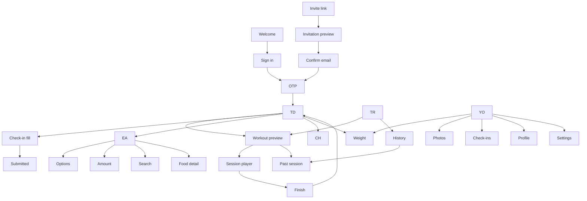

# Client app — full UX specification

Date: 2026-07-21
Status: approved for design
Scope: the entire client-facing app, designed fresh from the backend's client API surface (`/v1/client`, `/v1/auth`), the product-capabilities docs, and competitive research. The previous client app was deliberately not consulted.

This document is written for a UI designer. Every screen lists zones, exact copy, data bindings, formats, interactions, and states. Computed values include their formulas. Companion document: `2026-07-21-client-detail-ux-spec.md` (coach side) — shared format rules are repeated here so this file stands alone.

## Research basis (summary)

Competitive synthesis (Everfit, Trainerize, TrueCoach, CoachRx, PT Distinction client apps; Hevy/Strong/Boostcamp for workout logging; MacroFactor/Everfit for food logging; WHOOP for check-in psychology):

* The converged client-app IA is a bottom tab bar with a "Today" screen first. Today is a per-day checklist (workout, meals, tasks), not a stats dashboard.
* The gold-standard set-logging row is weight | reps | checkmark, where the checkmark completes the set and starts the rest timer in one tap. "Last time you did X" inline is the single most-loved feature in Hevy/Strong.
* Plan-based food logging must make "ate as planned" one tap; search and manual entry are fallbacks.
* Check-ins complete when they are scheduled tasks with structured inputs and resumable drafts; they get abandoned as long free-text forms.
* Adherence-neutral tone retains coached clients: a missed day is gray, never red. Guilt churns.
* The loudest complaint category across every incumbent is reliability: logged data lost to sync failures, crashes mid-workout. Chat split into a second app (TrueCoach) is a known failure.
* Clients consistently want to see their plan ahead; hiding future days frustrates gym scheduling.

Product decisions taken from this (each reflected in the spec below): five flat tabs instead of nested sections; one-tap set completion with auto rest timer; one-tap meal logging; local draft autosave for check-ins; neutral missed-state colors; full plan browsable; write operations queued locally and retried so a logged set is never lost.

---

## 0. Screen inventory and navigation map

The app is a mobile app (Android native via Capacitor + mobile web). Design reference width 375px; everything must also work at tablet width but mobile is primary.

| ID | Screen | Reached from | Type |
|----|--------|--------------|------|
| AU-1 | Welcome | App open, signed out | Page |
| AU-2 | Sign in (email) | AU-1 | Page |
| AU-3 | OTP entry | AU-2, AU-5 | Page |
| AU-4 | Invitation preview | Invite link | Page |
| AU-5 | Accept invite (email confirm) | AU-4 | Page |
| AU-6 | Invite invalid/expired | Invite link | Page |
| LK-1 | Locked out | Any 403 `client_inactive` | Full-screen takeover |
| TD | Today | Tab 1 (default) | Tab root |
| TR | Train | Tab 2 | Tab root |
| TR-2 | Workout preview | TD, TR | Page |
| TR-3 | Session player | TR-2, TD resume banner | Page |
| TR-4 | Exercise detail | TR-2, TR-3, TR-6 | Page |
| TR-5 | Swap exercise picker | TR-3 | Sheet |
| TR-6 | Finish workout | TR-3 | Page |
| TR-7 | Workout history | TR, YO | Page |
| TR-8 | Past session detail | TR-7, TD | Page |
| EA | Eat | Tab 3 | Tab root |
| EA-2 | Meal option switcher | EA | Sheet |
| EA-3 | Amount sheet (log/edit item) | EA | Sheet |
| EA-4 | Add food (search) | EA | Page |
| EA-5 | Food / recipe detail | EA, EA-4 | Page |
| CH | Coach (chat) | Tab 4 | Tab root |
| CH-2 | Attachment viewer | CH | Full-screen |
| YO | You | Tab 5 | Tab root |
| YO-2 | Weight | YO, TD | Page |
| YO-3 | Progress photos | YO | Page |
| YO-4 | Check-in history | YO | Page |
| CI-1 | Check-in fill | TD, YO-4 | Page (flow) |
| CI-2 | Check-in submitted | CI-1 | Page |
| CI-3 | Photo capture (ghost overlay) | CI-1 | Full-screen camera |
| YO-5 | Profile | YO | Page |
| YO-6 | Settings | YO | Page |

Bottom tab bar, five items, labels and icons:

| Tab | Label | Icon (lucide) | Badge |
|-----|-------|---------------|-------|
| 1 | `Today` | `Sun` | dot when an open check-in or intake exists |
| 2 | `Train` | `Dumbbell` | — |
| 3 | `Eat` | `UtensilsCrossed` | — |
| 4 | `Coach` | `MessageCircle` | unread count from conversation `unread_count` |
| 5 | `You` | `User` | — |

Rationale for five flat tabs: nutrition logging happens several times a day and earns direct access; folding Train and Eat into one "Plan" tab adds the nesting that is the most-cited competitor complaint. Five is the platform maximum and every tab maps to a distinct daily job.

---

## 1. Global rules

### 1.1 Formats

Identical to the coach spec §1.1 and repeated here: dates `15 Jul` (current year) / `15 Jul 2025` (other), `ddd D MMM` within ±7 days in lists, relative `Today` / `Yesterday` / `{n}d ago` up to 7 days; time `6:42 pm`; weight 1 decimal `72.4 kg`; calories `1,850 kcal`; macros `160 g`; duration `52m` / `1h 12m`; percentages `80%`. Units render as stored — never convert, except charts, which convert mixed-unit weight series to the unit of the most recent entry.

`reps` is a free-text string end to end ("8-12", "AMRAP"). Render verbatim; the reps input is plain text with a numeric-first keyboard, not a number field.

### 1.2 Tone and color semantics

* Voice: second person, warm, plain. The coach is "your coach" or the coach's first name (from `GET /me` coach summary) — never "the trainer".
* Adherence-neutral: anything not done (missed workout, unlogged day, missed check-in) renders muted/gray. Danger red is reserved for destructive actions and errors. Success green marks things done. This is a hard rule; no guilt states.
* No gamified streaks. The only aggregate shown to clients is the current week ("3 of 4 workouts this week").

### 1.3 Reliability (design-visible requirements)

* Writes during a workout or meal logging are optimistic: the UI updates instantly, a queued write retries in the background. A subtle `CloudOff` icon appears in the screen header while unsynced writes exist, with no blocking dialogs. Tapping it shows a sheet: `Waiting for connection. Your log is saved on this phone and will sync automatically.`
* A logged set or meal must survive app kill and offline gyms. Never show a spinner between sets.
* Check-in answers autosave to device storage per assignment (backend has no drafts); reopening an in-progress check-in restores them, with a small banner `Draft restored`.

### 1.4 Loading, error, empty

* First load per tab: skeleton shaped like the content. Never a centered spinner on first paint.
* Fetch failure: full-tab error state — title `Couldn't load`, body `Check your connection and try again.`, button `Retry`.
* Every empty state names who acts next (usually the coach) — the client should never wonder if the app is broken. Exact strings per screen below.

### 1.5 Auth/session behavior

* Tokens: 5-minute access, 7-day refresh, silent refresh. Refresh failure → sign-out to AU-2 with toast `Please sign in again.`
* Any `/v1/client` response of 403 `client_inactive` → LK-1 takeover (§10).

---

## 2. Auth and onboarding screens

### AU-1 Welcome

Full-screen brand moment. Logo, app name, one line: `Coaching from your coach, in your pocket.` Buttons: primary `Sign in`, ghost `I have an invite link` (opens the system prompt to paste a link; parsing extracts the token and routes to AU-4). Most invited clients arrive via the link directly and never see AU-1.

### AU-2 Sign in

* Title `Sign in`. One field: `Email` (`type=email`, autofocus). Primary button `Continue` → `POST /v1/auth/otp {email, type}` → AU-3.
* Error (unknown email): inline under field, `We couldn't find that email. Use the email your coach invited, or ask them for a new invite.`
* No signup path — the client app is invite-only. No password anywhere.

### AU-3 OTP entry

* Title `Check your email`. Body `We sent a 6-digit code to {email}.` Six-box OTP input, auto-advance, auto-submit on 6th digit → `POST /v1/auth/verify` (or `accept-invite/verify` when in the invite flow).
* Link `Resend code` — disabled 30s with countdown `Resend in {n}s`; on tap, toast `Code sent`.
* Errors inline: wrong code `That code didn't match. Try again.`; expired `That code expired. We sent a new one.` (auto-resends once).
* Success in the invite flow → straight to TD with the first-run state (§3.1). Success on plain sign-in → TD.

### AU-4 Invitation preview

Opened from the invite link. `GET /v1/auth/invitations/:token`.

* Centered card: business name large, `{coach first name} invited you to start coaching.` Button primary `Accept invite` → AU-5. Below, muted: `Invited as {email}` when the invite has an email.

### AU-5 Accept invite — confirm email

* Title `Where should we send your code?` Email field prefilled from the invite (editable — acceptance email may differ). Button `Send code` → `POST /v1/auth/accept-invite {invitation_token, email}` → AU-3.
* Seat-full failure (backend conflict): error screen — `Your coach's roster is full right now. Ask {coach first name} to make room, then open this link again.` Button `Done`.

### AU-6 Invite invalid / expired

* Icon `LinkBroken` equivalent (`Unlink`), title `This invite link isn't valid`, body `It may have expired or been revoked. Ask your coach to send a fresh one.` No actions.

---

## 3. TD — Today

The home tab. A dated checklist for one day, today by default. Header: greeting `Good morning, {first_name}` (morning <12pm, `Good afternoon` <5pm, else `Good evening`), date sub-line `ddd D MMM`. Optional sync icon per §1.3. No date switcher on Today — other days live in Train/Eat.

Cards render in this fixed priority order; absent cards collapse.

### 3.1 Intake card (stage = onboarding, intake not completed)

Soft primary-tinted card, always first. Title `Tell {coach first name} about you`. Body `A few questions so your coach can build your plan. Takes about 5 minutes.` Button primary `Start` → CI-1 rendering the intake assignment. In-progress draft: button reads `Continue` and a thin progress bar shows answered/total questions.

First-run (immediately after invite acceptance) the app lands here with a one-time toast `You're in. Welcome to {business name}.`

### 3.2 Check-in card (an open check-in assignment exists, due today or overdue)

Title `Check-in`. Body `{template name} · due {due_date}` (or `was due {due_date}` when overdue — muted text, not red). Button primary `Start` / `Continue` (draft exists). → CI-1. When both intake and check-in are open, intake card is first (matches backend nudge priority).

### 3.3 Today's workout card

Data: `GET /v1/client/training-plans/today`.

* Scheduled workout, not yet started: title = workout name, sub `{n} exercises · about {estimate} min` (estimate = sum of planned sets × (30s + rest_seconds, default 60s when null), rounded to 5). Coach workout `notes` as a muted line when present. Button primary full-width `Start workout` → TR-3 (creates the session). Secondary text link `Preview` → TR-2.
* Session in progress (an `active` session exists): card becomes a resume banner — `Workout in progress · {elapsed}` with button `Resume` → TR-3. This banner also appears sticky above the tab bar on every tab while a session is active.
* Completed today: card in done state — check icon, `{workout name} · Done`, sub `{completed sets} sets · {duration}`, link `View` → TR-8.
* Rest day (no schedule entry for today's weekday): compact card `Rest day` with sub `Nothing scheduled. Recovery counts.` Ghost button `Log a workout anyway` → starts a freestyle session (TR-3 empty variant).
* No active plan: `Your coach is building your training plan.` sub `You'll see it here the moment it's ready.` No button. (Message the coach lives in the Coach tab; don't duplicate.)

### 3.4 Today's meals card

Data: `GET /v1/client/nutrition-plans/today` + today's meal logs.

* With a plan: title `Meals`, then one compact row per meal slot that has planned meals: slot label, chosen meal name (truncated), right side either logged state (`✓ 520 kcal`) or ghost button `Log`. `Log` one-taps the whole planned meal (`log-meal`) with an undo toast `{slot} logged · Undo` (undo deletes the created entries). Row tap → EA scrolled to that slot.
* Footer: calories meter `1,240 / 1,900 kcal` (ProgressBar, success within 85–110% at day end, otherwise neutral — never red).
* No plan: `Your coach is building your nutrition plan.` sub `You'll see meals here when it's ready.`

### 3.5 Weight quick-log card (shown only when no weight entry exists for today AND the latest entry is ≥ 7 days old)

Title `Log your weight`. Inline number field prefilled with the last value, unit label from last entry (default `kg`), button `Save` → `POST /weight_entries` (upsert by date), card flips to `✓ 72.4 kg logged` for the rest of the day. Rationale: gentle cadence without daily nagging; check-ins remain the primary weight channel.

### 3.6 This-week strip (bottom of Today)

Seven columns, Monday-start week, today highlighted. Two dot rows labeled at the left edge `Workouts` and `Meals` (same labeled-rows pattern as the coach spec §3.2 — no legend to decode), with neutral colors: done = success, missed/not logged = muted gray (never danger), rest = hollow. Caption `3 of 4 workouts this week`. Not tappable.

---

## 4. TR — Train

### 4.1 Tab root

Header `Train`. Content:

* Plan card: plan name, `{start_date} – {end_date}`, coach `description` as collapsible text.
* Week schedule list: seven rows, Monday-start, resolved from schedule entries. Each: `ddd D MMM` + workout name or `Rest`, chip `Today` on today, checkmark on days with a completed session, muted `Missed` text chip (gray) on past scheduled days with no session. Tap a workout row → TR-2 for that workout.
* Full-plan browse: below the week, section `All workouts` listing every workout in the plan (name + exercise count) → TR-2. The whole plan is visible — clients plan their gym week ahead; nothing is hidden.
* Link row `Workout history` → TR-7.
* No plan: same empty state as §3.3.

### 4.2 TR-2 workout preview

Header: back, workout name, sub `{n} exercises`. Coach workout notes as an info callout when present. List: one row per exercise (position order, superset groups bracketed — see §4.3): exercise thumbnail (media image or first legacy image; placeholder dumbbell icon otherwise), name, sets summary `4 × 8-12 · 60 kg` (working sets count × reps text · top load when present). Row tap → TR-4. Sticky footer button `Start workout` (creates session → TR-3). If this workout's session is already completed today, footer reads `Start again` (a second session is allowed).

### 4.3 TR-3 session player

Created via `POST /training-sessions {training_workout_id}` (snapshot taken server-side). Freestyle variant: created with no workout id; starts empty with an `Add exercise` button only.

Layout: full-screen page, no tab bar. Header: elapsed timer (mm:ss, live), workout name, `⋯` menu (`Discard workout` — AlertDialog: title `Discard this workout?`, body `Logged sets will be deleted.`, confirm `Discard` danger). Finishing lives at the bottom.

Body: one card per exercise in order. Superset groups (shared `superset_group_id`) render inside one bracketed container labeled `Superset` with a muted caption `Alternate these exercises` (the caption explains the concept to clients who've never heard the word), member exercises marked A1/A2.

Exercise card anatomy:

* Header row: thumbnail (tap → TR-4 in a sheet, video plays there), exercise name, `⋯` menu: `Swap exercise` (→ TR-5), `Exercise info` (→ TR-4).
* Coach exercise `notes` (from the workout element): muted line under the name.
* `Last time` line (when history exists): `Last time: 60 kg × 8, 8, 7 · {date relative}` — computed from the most recent completed session containing this `exercise_id` (sessions index lookup). Absent for first-timers.
* Set rows, one per planned set, in order. Columns adapt to the exercise `tracking_type` (mapping below). Each row: set number (warm-up rows show `W`, drop sets `D`, muted), input fields pre-filled with the planned values as editable text (planned values render as real input text, not placeholders — confirming an unchanged prescription is zero typing), then a large (44px+) checkmark button.
* Checkmark tap = the set is done: writes the performed set (`completed: true`) and, when the planned set has `rest_seconds`, starts the rest timer. Row locks to a done state (tap again to unlock/edit).
* Below planned rows: ghost row `+ Add set` (duplicates the last row's values).
* A planned set left unchecked is simply not logged — that is "skipped"; no explicit skip control, no penalty color.

Tracking-type → input columns (labels shown as field captions):

| `tracking_type` | Inputs |
|---|---|
| `weight_reps` | load (`kg`/`lbs` caption) · `reps` |
| `bodyweight_reps` | `reps` only — load column shows the word `Bodyweight`, no cryptic `BW` |
| `weighted_bodyweight` | load with caption `kg added` · `reps` |
| `assisted_bodyweight` | load with caption `kg assist` (the help from the machine or band) · `reps` |
| `reps_only` | `reps` |
| `duration` | `time` (mm:ss picker) |
| `weight_duration` | load · `time` |
| `distance_duration` | `distance` (+unit) · `time` |
| `weight_distance` | load · `distance` |

RPE: when the planned set carries an `rpe`, an `RPE` field appears after the main inputs, prefilled. Otherwise hidden (available under the row's overflow, `Add RPE`).

Engineering note: the plan-for-today payload omits `tracking_type`; resolve it from the exercise read endpoint and cache. Design as if always present.

Rest timer: on set completion, a bottom bar slides up: `Rest · 1:30` counting down, buttons `−15s` `+15s` `Skip`. It persists across scrolling, ticks in the background, and fires a local notification chime + haptic at zero (`Rest over — next set`). Only one timer at a time; completing another set restarts it.

Swap (TR-5): sheet with search over `GET /training-exercises` (name search), rows show thumbnail + name + muscles. Header `Swap {exercise name}`. Picking one replaces the card for this session only: card title shows the replacement with sub `Swapped from {original}`; planned set targets carry over; performed sets log `swapped_from_exercise_id`. Copy at sheet top: `Your coach will see the swap.`

Add exercise (bottom of the session): ghost button `+ Add exercise` → same picker, appends a card with one empty set. Sets log with `source` semantics naturally (they're just extra performed sets).

Sticky footer: primary full-width `Finish workout` → TR-6. Finish with zero completed sets prompts: `Nothing logged yet. Discard instead?` options `Keep going` / `Discard`.

### 4.4 TR-6 finish workout

* Celebration header (subtle, no confetti spam): `Nice work.` Summary rows: `Duration {h}m`, `Sets {completed} of {planned}`, `Total lifted {total} kg` (Σ load×reps over completed weight sets; hidden when zero — "volume" is lifter jargon, "total lifted" is plain).
* `How sore are you?` — five-dot tap row (1–5), optional, caption `1 = fresh · 5 = very sore`.
* `Anything for {coach first name}?` — optional multiline field, placeholder `Felt strong today…`.
* Button primary `Done` → `PATCH /training-sessions/:id {state: completed, ended_at, soreness_rating, notes}` → back to TD (card in done state, one-time toast `Workout saved`).

### 4.5 TR-7 history and TR-8 past session

* TR-7: infinite list of sessions, newest first, grouped `This week` / `Last week` / `Week of {date}`. Row: `ddd D MMM` · workout name · `{sets} sets · {duration}` · state chip only for `discarded` (`Discarded`, muted).
* TR-8: read-only mirror of the session player layout with values frozen; header adds date. Swapped exercises show the `Swapped from` sub-line.

### 4.6 TR-4 exercise detail

Media at top: video player (mp4/webm, tap to play, muted autoplay off) or image; legacy `images[0]` fallback; icon placeholder otherwise. Name, muscle chips + equipment chips (outline). Sections: `Instructions` (numbered when the text contains line breaks), `Description`. Section `Your history` — per-exercise past performed sets grouped by session date, newest first (`13 Jul — 60 kg × 8, 8, 7`).

---

## 5. EA — Eat

### 5.1 Tab root — the day view

Header: `Eat`, date switcher (`‹ ddd D MMM ›`, swipe or arrows; jump-to-today pill appears when not on today; future dates browsable read-only — logging controls hidden for future dates).

Data: `nutrition-plans/today?date=` + `nutrition-meal-logs?date=`.

* Day totals card, top: meters `Calories · Protein · Carbs · Fat` (+ `Fiber` when target set), `{logged} / {target}`, neutral coloring per §1.2.
* One card per meal slot that has planned options (slot order fixed: Breakfast, Morning snack, Lunch, Afternoon snack, Dinner, Evening snack). Card:
  * Header: slot label, right `{logged} kcal` when anything is logged.
  * Chosen meal name + total planned kcal. When the slot has >1 option: chip `Option {n} of {m}` — tap → EA-2.
  * Item rows: food/recipe name, `{amount} {unit}` or `{weight_g} g`, kcal. States: planned-unlogged (normal), logged (check icon, success tint), replaced (`Swapped` chip + the replacement's name), skipped-after-day-logged (struck muted).
  * Item row tap: unlogged → EA-3 prefilled with planned amount (`Log` primary action; `Swap for something else` secondary → EA-4 in replacement mode); logged → EA-3 in edit mode (`Save` / `Remove`).
  * Card footer: button `Log meal as planned` (one tap, `log-meal`, undo toast) — hidden once ≥1 item from the slot is logged.
* Unplanned section per slot: logged `unplanned` entries render under the planned items with an `Added` chip.
* Below the last slot: ghost button `+ Add food` → EA-4 (unplanned mode, slot picker inside the amount sheet).
* Sticky quick action (visible until the day has any log): `Log whole day as planned` (`log-day`, confirm sheet `Log all planned meals for {date}?` → `Log day`, undo toast).
* Empty day (plan exists, weekday has no day-type meals): `Nothing planned today.` + `+ Add food`.
* No plan: §3.4 empty state.

### 5.2 EA-2 meal option switcher

Sheet titled `{slot label}`. One card per option (max 3): meal name, kcal + `P/C/F` line, item name list (muted, truncated to 2 lines), chip `Current` on the chosen one, chip `Coach's default` on position 0. Tap → `switch-option`, sheet closes, toast `Switched to {meal name}`. When the slot already has logs: confirm first — `Switching clears today's log for this meal.` `Switch` / `Cancel`.

### 5.3 EA-3 amount sheet

Bottom sheet. Title: item name. Sub: per-serving macro line. Controls:

* Amount: number field + unit `Select` (options: the food/recipe `serving_sizes` labels + `g`). Stepper buttons ∓ for quick adjust. Live macro preview updates as typed: `{kcal} kcal · P {n} · C {n} · F {n}`.
* Optional `Note` field (collapsed behind `Add note`).
* Primary button: `Log` (create) / `Save` (edit). Edit mode adds ghost `Remove` (deletes the entry, undo toast).

### 5.4 EA-4 add food (search)

Full page, search field autofocused, searching `nutrition-foods` and `nutrition-recipes` (two result groups with headers `Foods` / `Recipes`). Row: name, brand muted, kcal/100g. Tap → EA-3 in the appropriate mode (replacement carries `planned_item_index` + `source: replacement`; unplanned carries `source: unplanned` + a slot `Select` defaulting to the nearest upcoming slot). Empty results: `Nothing found. Ask your coach to add it to the library.`

### 5.5 EA-5 food / recipe detail

From tapping the info affordance on any item row. Food: image (media/`image_url` fallback), name, brand, macros per 100g table, allergens + dietary tag chips, serving sizes list. Recipe: description, `Ingredients` list (per ingredient: food name + grams), numbered `Instructions`, servings count. Read-only.

---

## 6. CI — check-in and intake fill flow

One renderer for both purposes (`purpose: intake` styles the header differently; no review chip logic client-side).

### 6.1 CI-1 fill

Header: back (autosaves draft locally, silent), title = template name, progress `{answered}/{total}` as a thin top bar. Body: sections in order, each with its optional section title; one question block per question:

* Label + `*` for required. Inputs by type:
  * `text` → multiline field, placeholder `Type your answer…`
  * `number` → numeric field
  * `boolean` → two ToggleButtons `Yes` / `No`
  * `date` → date picker
  * `select` → chip group, single-select
  * `multi_select` → chip group, multi-select
  * `rating` → five large dots (1–5), captions `1 = poor · 5 = great` (generic; the question label carries meaning)
  * `weight` → number field + unit label; caption `Also saved to your weight log`
  * `photo` → 1–4 photo tiles: `+` tile opens a chooser sheet `Take photo` (→ CI-3) / `Choose from library`; thumbnails removable (× overlay) before submit; upload runs immediately in the background with a progress ring on the tile; a failed upload shows `Retry` on the tile
* Sticky footer: primary `Submit`. Disabled while any photo upload is unfinished (caption under button `Uploading photos…`) or any required answer is empty (tapping while disabled scrolls to the first missing one, field shakes + inline `This one's required.`).
* Submit → `POST /form-assignments/:id/submit {answers}` (single transaction server-side) → CI-2. Double-tap guarded client-side. Failure keeps the user on the form with the standard error toast `Couldn't submit. Your answers are saved on this phone — try again.`

### 6.2 CI-2 submitted

Check icon, title `Sent to {coach first name}` (intake variant: `Thanks — {coach first name} has what they need.`), body `You'll hear back in chat.` Button `Done` → TD.

### 6.3 CI-3 photo capture with ghost overlay

Full-screen camera. Toggle row above the shutter: `Front · Side · Back · Free` pose tags (stored client-side as capture metadata for the overlay feature only). When a previous photo with the same pose tag exists (from any earlier submission), it renders at 30% opacity over the viewfinder with a toggle labeled `Show last photo` — line up, then shoot. ("Ghost overlay" is the internal feature name only; it never appears in the UI.) Shutter → confirm screen (`Use photo` / `Retake`). This is the one deliberate delight feature; no competitor coached app has it.

---

## 7. CH — Coach (chat)

Single conversation, no inbox. Header: coach avatar + business name, sub-line `{coach first name}` when available. Realtime via Phoenix channel `conversation:{id}`, event `message_new`; reconnect refetches since the newest local id.

* Message list: bubbles (client right/primary, coach left/surface), day separators (`Today`, `Yesterday`, `D MMM`), timestamps on tap. Cursor pagination upward (`?before=`).
* Attachments in bubbles: images as tap-to-view thumbnails (CH-2 viewer with pinch-zoom, swipe between a message's images), video with play overlay, voice notes as a play bar with duration.
* Coach-sent check-in embeds: a compact card inside the bubble — `Check-in · {title} · {submitted date}` → opens the read-only submission view (reuses CI-1 rendering, frozen).
* Composer: text field (`Message {coach first name}…`), `+` attach (photo/video via picker; ≤4 per message), mic button for voice notes (hold-to-record, ≤5 min, slide-to-cancel, preview before send). Send disabled while uploads are unfinished.
* Mark-read fires on screen focus (`POST /conversation/read`); tab badge clears.
* Empty (no messages ever): centered `Say hi to {coach first name}.` with the composer focused. (No emoji — the design system bans them.)

---

## 8. YO — You

Profile-and-progress tab. Header: avatar (initials), name, `{business name}` sub-line.

Sections (list rows / cards in order):

* Weight card: latest value + 4-week delta (neutral arrows), 90-day sparkline, goal line when `goal_weight_value` set. Tap → YO-2.
* Row `Progress photos` (3 latest thumbnails inline) → YO-3. Hidden when no photos exist.
* Row `Check-ins` → YO-4.
* Row `Workout history` → TR-7.
* Row `Profile` → YO-5.
* Row `Settings` → YO-6.

### YO-2 Weight

* Chart (range toggles `1M · 3M · 6M · All`, default 3M). Under it, one plain sentence built from the index response: `▼ 1.2 kg in 4 weeks` plus `· 1.8 kg to your goal of 68 kg` when a goal is set (omit the goal clause otherwise; first-entry-only shows `First entry — log weekly to see your trend.`).
* Button `Log weight` → sheet: date (default today), value, unit toggle `kg/lbs`, note. Same-date save overwrites (backend upsert) — sheet shows `Replaces today's entry` caption when one exists.
* Entry list: `D MMM · 72.4 kg` + source caption `From check-in` (has `form_submission_id`, not deletable) / client-logged rows get swipe-to-delete with undo toast.

### YO-3 Progress photos

Grid grouped by submission date (newest first), sourced from the client's own completed submissions' photo answers. Compare mode identical to coach spec §6.6 (select two, side-by-side, dates labeled). Pose tags from CI-3 shown as tiny corner chips when present.

### YO-4 Check-in history

List of check-in assignments, newest first: template name + status chip — `Due {date}` (outline), `In progress` (soft warning), `Submitted {date}` (soft success), `Missed` (muted gray, not openable, sub-line `This one closed. The next check-in will appear on Today.`), `Dismissed` (muted). Completed rows open the frozen submission view. Reviewed state shows as a sub-line `Seen by {coach first name}` when `reviewed_at` is set — the client-visible "your coach saw this" signal.

### YO-5 Profile

Editable fields (the only editable ones the API allows): `First name`, `Last name`, `Phone`, `Goal weight` (value + unit). Save → `PATCH /me`, toast `Profile updated`. Email shown read-only with caption `Your sign-in email. Ask your coach to change it.`

### YO-6 Settings

* `Notifications` — OS-permission row with a `Switch` reflecting system permission (deep-links to system settings when off). Sub-toggles (local preferences): `Messages`, `Check-in reminders`, `Rest timer sound`.
* `About` — app version, links `Privacy policy`, `Terms`.
* `Sign out` — danger ghost, AlertDialog `Sign out?` body `Your unsent drafts stay on this phone.` confirm `Sign out` → clear tokens → AU-1.
* No delete-account or change-email (no API); intentionally absent.

---

## 9. Notifications (push)

FCM, Android native first. Types and behavior (backend spec exists; token endpoint is a build prerequisite):

| Type | Title | Body | Tap routes to |
|------|-------|------|----------------|
| `chat_message` | sender display name | message text ≤140 chars | CH |
| `checkin_due` | `Check-in due` | check-in name | TD (check-in card) |
| local: rest timer | `Rest over` | `Next set.` | TR-3 (foreground resume) |

Register token after sign-in (native only), delete on sign-out. No notification center in-app; the tab badges are the in-app signal. Max one `checkin_due` push per occurrence (backend-controlled); the app never schedules its own reminder pushes beyond the rest timer.

---

## 10. Lifecycle state matrix

| State | Detection | App behavior |
|-------|-----------|--------------|
| Signed out | no tokens | AU-1 |
| Invited, not accepted | invite link | AU-4 → AU-5 → AU-3 |
| Active · onboarding | `/me` stage `onboarding` | Full app; TD leads with intake card (§3.1); Train/Eat show "coach is building" empties until plans arrive |
| Active · coaching | stage `coaching` | Full app, steady state |
| Locked out | any 403 `client_inactive` | LK-1 takeover (below) |
| Token refresh failed | 401 on refresh | Sign-out → AU-2, toast |

### LK-1 Locked out

Full-screen, replaces everything (tab bar hidden). Icon `Lock`, title `Your coaching isn't active right now`, body `Your access to {business name} is paused. Contact {coach first name} to get going again.` (names from cached `/me`). Buttons: `Call {coach first name}` (tel:, only when a cached coach/business phone exists) and ghost `Sign out`. The API cannot distinguish expiry vs manual vs seats client-side (single `client_inactive` error) — one screen covers all. Data already on device stays viewable? No: every endpoint is blocked; the takeover is total. Retry silently on app foreground; if the account is active again, the app resumes seamlessly.

---

## 11. Data appendix — endpoint per surface

| Surface | Endpoint(s) |
|---------|-------------|
| Invite preview / accept | `GET /v1/auth/invitations/:token`, `POST /v1/auth/accept-invite[, /verify]` |
| Sign in | `POST /v1/auth/otp`, `POST /v1/auth/verify`, `POST /v1/auth/token` |
| Me / profile | `GET/PATCH /v1/client/me` |
| Today workout | `GET /training-plans/today` |
| Plan browse | `GET /training-plans[/:id]` |
| Exercise detail / swap search | `GET /training-exercises[/:id]` |
| Session lifecycle | `POST/PATCH/GET /training-sessions[/:id]` |
| Set logging | `POST /training-sessions/:id/performed-sets`, `PATCH/DELETE /training-performed-sets/:id` |
| Nutrition day | `GET /nutrition-plans/today?date=`, `GET /nutrition-meal-logs?date=` |
| Meal logging | `POST /nutrition-food-log-entries[/log-meal | /log-day | /switch-option]`, `PATCH/DELETE /nutrition-food-log-entries/:id` |
| Food search/detail | `GET /nutrition-foods[/:id]`, `GET /nutrition-recipes[/:id]` |
| Weight | `GET/POST /weight_entries`, `DELETE /weight_entries/:id` |
| Forms (intake + check-in) | `GET /form-assignments[/:id]`, `POST /form-assignments/:id/submit` |
| Photo/attachment upload | `POST /uploads`, `POST /attachments/download-urls` |
| Chat | `GET /conversation[, /messages]`, `POST /conversation/messages`, `POST /conversation/read`; channel `conversation:{id}` |

## 12. Backend follow-ups this design surfaces (queue, don't block design)

1. Push-token endpoint (`POST /v1/push-tokens`) + `checkin_due` trigger — per the approved push spec; the notifications section assumes it.
2. `tracking_type` missing from the plan-for-today payload — add it to the client plan representation so the session player needn't join against the exercise library.
3. Server-side form drafts — local autosave covers v1; server drafts would let clients switch devices mid-check-in.
4. Coach-defined exercise alternatives — swap currently searches the whole library; a coach-curated alternatives list per exercise would tighten it.
5. Voice-note/video attachment types on the client message request — confirm the request schema accepts them (rich-chat spec says yes; verify before build).

## 13. Deliberately rejected (and why)

* Streaks and gamified scores — guilt mechanics churn coached clients; weekly counts only.
* A second messaging surface or per-topic threads — one conversation is the product.
* Client-side subscription/payment screens — no API, coach-managed by design; the lock screen is the whole billing UX.
* Barcode scanning and third-party food databases — the coach's library is the source of truth; broken integrations are the top complaint category in incumbents.
* Apple Health / Google Fit sync, wearables — no backend; revisit post-v1.
* Hiding future plan days — the API returns the full plan; artificial hiding frustrates clients (research (a)/(f)).
